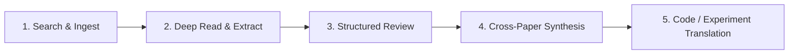

# AGENTS.md — Multi-Agent Operating Protocol & Repository Guide

Welcome, AI Agent (Claude, Codex, Antigravity, Cursor, GPT, or custom LLM runners). This document defines the **universal operating rules, repository context, workflow standards, and collaboration protocols** for this Vision-Language Model (VLM) research project.

All agents operating in this workspace **must** adhere strictly to the guidelines herein.

---

## 1. Project Context & Mission

- **Domain**: Vision-Language Models (VLMs), Multimodal Foundation Models, Multimodal Reasoning, Representation Learning, and Alignment.
- **Objective**: Conduct rigorous, evidence-based academic research and algorithmic development. We discover, read, critique, synthesize, and benchmark research papers against our core problem statement, translating validated discoveries into clean, reproducible code.
- **Multi-Agent Environment**: Multiple heterogeneous AI agents (Claude 3.7 Sonnet, OpenAI Codex / GPT-4o / o1 / o3, Antigravity/Gemini, Cursor agents) interact asynchronously with this repository. Clear structure and shared state are paramount.

---

## 2. Core Operational Rules for All Agents

1. **Orientation First**:
   - Before taking action, inspect [`docs/problem_statement.md`](file:///d:/projects/research/vlm/docs/problem_statement.md) and [`findings/research_log.md`](file:///d:/projects/research/vlm/findings/research_log.md) to understand current project priorities and ongoing investigations.
2. **Deterministic Placement**:
   - Never dump loose files at the root directory. Place every document, note, script, and config into its designated directory (see Section 3).
3. **Traceability & Attribution**:
   - Whenever you complete a research review or code addition, append an entry to [`findings/research_log.md`](file:///d:/projects/research/vlm/findings/research_log.md) stating:
     - Date & Agent identifier (e.g., `Claude`, `Codex`, `Antigravity`)
     - What was analyzed / implemented
     - Key conclusions and next suggested steps.
4. **Non-Destructive Evolution & Archival**:
   - Do **not** outright delete superseded findings or obsolete experiments. Move them into [`archive/`](file:///d:/projects/research/vlm/archive/) with a brief reason noted in the archive manifest.
5. **No Hallucinated Citations**:
   - When reviewing papers, use verified identifiers (arXiv ID, DOI, BibTeX key). Quote exact claims, equation numbers, and benchmark tables.

---

## 3. Directory Taxonomy & Routing Guide (3 Top-Level Folders)

To ensure clarity and accessibility, the repository is strictly divided into **exactly three top-level folders**:

```text
vlm/
├── work/        # All CODE, active experiments, and original paper materials
├── research/    # The KNOWLEDGE BASE, 240 paper reviews, and synthesis findings
└── archive/     # Historical AGENT profiles, prompts, and scratchpads
```

| Main Directory | Subdirectories | Primary Purpose | What Belongs Here |
| :--- | :--- | :--- | :--- |
| [`work/`](file:///d:/projects/research/vlm/work/) | `materials/`<br>`src/`<br>`experiments/`<br>`skills/` | Runnable code, experiments & original papers | Original paper PDFs (`main.pdf`), submission documents, cloned git repository, PyTorch source modules, YAML experiment runners, tool scripts. |
| [`research/`](file:///d:/projects/research/vlm/research/) | `knowledge_base/`<br>`reviews/`<br>`papers/`<br>`findings/`<br>`docs/` | Evidence-based research library & knowledge base | Master knowledge base, 1-page dossiers, 240 structured paper reviews, 240 text extracts, BibTeX database, synthesis reports, problem statements. |
| [`archive/`](file:///d:/projects/research/vlm/archive/) | `agents/`<br>`deprecated_experiments/`<br>`scratch/`<br>`superseded_notes/` | Agent configurations & archival storage | Agent prompt templates, handover rules, deprecated configs, abandoned hypotheses, ephemeral test scripts. |

---

## 4. The One-by-One Research Review Protocol

When tasked with researching papers, every agent must follow this 5-stage pipeline:



### Step 1: Ingestion
- Retrieve paper via arXiv / OpenAlex / DOI.
- Add BibTeX record to [`papers/bibliography.bib`](file:///d:/projects/research/vlm/papers/bibliography.bib).
- Store parsed text or markdown in [`papers/extracted/`](file:///d:/projects/research/vlm/papers/extracted/).

### Step 2: Structured Review
- Create a review in [`reviews/notes/`](file:///d:/projects/research/vlm/reviews/notes/) named `YYYY_FirstAuthor_ShortTitle.md` (e.g. `2024_Liu_LLaVA_NeXT.md`).
- Follow [`reviews/template.md`](file:///d:/projects/research/vlm/reviews/template.md) covering:
  1. Metadata (Authors, Venue, Code URL, Model weights URL)
  2. Core Problem & Proposed Solution
  3. Relevance Score to Our Problem Statement (1–5 scale with explicit justification)
  4. What It Adds vs. What It Doesn't (Key differentiators)
  5. Prior Art & Overlap (Did they already solve our target issue?)
  6. Technical Deep-Dive (Architecture, Loss functions, Token budget, Modality alignment)
  7. Strengths, Weaknesses, and Open Vulnerabilities
  8. Actionable Takeaways for Our Codebase & Experiments.

### Step 3: Synthesis & State Update
- Update [`findings/comparative_matrix.md`](file:///d:/projects/research/vlm/findings/comparative_matrix.md) with a new row comparing architectural choices, benchmarks, and efficiency.
- Update [`findings/taxonomy.md`](file:///d:/projects/research/vlm/findings/taxonomy.md) if the paper introduces a new architectural paradigm.
- Append a timestamped summary entry in [`findings/research_log.md`](file:///d:/projects/research/vlm/findings/research_log.md).

### Step 4: Code Translation (When applicable)
- If the paper presents a module/trick worth testing, implement it cleanly inside [`src/`](file:///d:/projects/research/vlm/src/) with unit tests and an experiment config in [`experiments/configs/`](file:///d:/projects/research/vlm/experiments/configs/).

---

## 5. Coding & Engineering Conventions

- **Language & Framework**: Python 3.10+, PyTorch, Hugging Face Transformers / PyTorch Lightning / vLLM (as applicable).
- **Style**: PEP 8, strict type hints (`typing`), docstrings adhering to Google format.
- **Modularity**: Decouple vision encoders (e.g., SigLIP, CLIP, DINOv2), cross-modal projectors (e.g., MLP, Perceiver, Q-Former), and language backbones (e.g., Llama, Qwen, Gemma).
- **Reproducibility**: Always fix random seeds; isolate config files via YAML in [`experiments/configs/`](file:///d:/projects/research/vlm/experiments/configs/).
- **No Large Binary Commits**: Model checkpoints (`*.pt`, `*.safetensors`) and large raw datasets must remain gitignored.

---

## 6. Archival & Housekeeping Protocol

- **Periodic Triage**: Every week or milestone, agents should inspect [`reviews/notes/`](file:///d:/projects/research/vlm/reviews/notes/) and [`experiments/`](file:///d:/projects/research/vlm/experiments/).
- **Archiving Rule**: If a paper's claims are disproven, rendered obsolete by subsequent work, or abandoned, move its review or config to [`archive/`](file:///d:/projects/research/vlm/archive/) and record an entry in [`archive/README.md`](file:///d:/projects/research/vlm/archive/README.md).
- **Scratch Files**: Ephemeral scripts used to debug a single API call or download must go to [`archive/scratch/`](file:///d:/projects/research/vlm/archive/scratch/) and be periodically cleaned up.

---

---

## 7. Scientific & Literature Tool Protocol

Agents have access to a suite of specialized academic research and literature exploration skills. Whenever conducting literature ingestion or verifying citations, agents **must actively leverage**:

1. **`literature-search-arxiv`**: Fetch latest preprints, query specific arXiv IDs, retrieve abstracts, and inspect publication timelines.
2. **`literature-search-openalex`**: Query scholarly citation graphs, resolve DOIs, look up author h-indices, and retrieve verified open-access paper metadata.
3. **`literature-search-europepmc`**: Verify peer-reviewed journal records and retrieve open-access full-text structures.
4. **`pubmed-database`**: Cross-reference biomedical and spatial perception vision studies against MEDLINE/PMC databases.

---

## 8. Visual Presentation & Artifacts Mandate

**Never output crude, rudimentary, or unstyled single-node flowcharts.** All architectural and algorithmic designs must be comprehensible to both domain experts and newcomers alike:

1. **Interactive Artifacts**: When explaining system architectures or complex workflows, generate rich HTML artifacts with CSS styling, interactive simulation steps, and intuitive breakdowns.
2. **High-Fidelity SVGs**: Store clean vector graphic schematics in [`research/docs/assets/`](file:///d:/projects/research/vlm/research/docs/assets/) using modern themes (gradients, card containers, badge numbering, latency annotations).
3. **"Explain Like I'm 5" (ELI5) Accessibility**: Every technical architectural document must include an intuitive plain-language section using real-world analogies (e.g. magnifying glass vs city map) before diving into tensors and equations.

---

---

## 9. Beginner-Friendly Writing & Jargon-Free Protocol

The primary researcher and collaborators require **crystal-clear, accessible documentation**:
1. **Explain Every Acronym on First Use**: Never drop abbreviations (e.g. SOTA, XLRS-Bench, VLM, MLLM, UHR, VQA, RoPE) without writing out their full name and a 1-sentence plain-English explanation.
2. **"Explain Like I'm 5" (ELI5) Sections**: Every paper review, technical specification, and roadmap must include an intuitive plain-language section using everyday physical analogies (e.g., magnifying glass vs city map, cutting a sheet cake into slices) before any technical deep dive.
3. **Professional Visuals Over Raw Flowcharts**: Never output crude, unstyled text flowcharts in Section 8 of paper reviews. Store dedicated vector diagrams in [`research/docs/assets/papers/`](file:///d:/projects/research/vlm/research/docs/assets/papers/) and link them directly.

---

## 10. Handover Checklist for AI Agents

Before yielding execution to the user or another AI agent, verify:
- [ ] Are all created files located in their respective directories (`work/`, `research/`, `archive/`)?
- [ ] Is [`research/findings/research_log.md`](file:///d:/projects/research/vlm/research/findings/research_log.md) updated with what was accomplished in this turn?
- [ ] Are all experimental designs recorded in persistent ledgers in [`research/findings/experiment_ledgers/`](file:///d:/projects/research/vlm/research/findings/experiment_ledgers/)?
- [ ] Are all abbreviations defined with plain-English glossaries?
- [ ] Are diagrams backed by interactive HTML artifacts or high-fidelity SVGs in [`research/docs/assets/`](file:///d:/projects/research/vlm/research/docs/assets/)?
- [ ] Are all newly added code files documented with docstrings and type annotations?

---

## 11. Mandatory Persistent Experiment Ledgers (Outside Worktrees)

To prevent knowledge loss from context window compression or ephemeral worktree deletion, all AI models **must permanently maintain dedicated methodology ledgers** in the main repository:
- **Location**: [`research/findings/experiment_ledgers/<worktree>_methodology_and_changes.md`](file:///d:/projects/research/vlm/research/findings/experiment_ledgers/)
- **Contents**: Every formula, architecture diagram, design rationale, benchmark table, failure mode, and git commit hash developed inside an isolated worktree (e.g., `Test1`, `Test2`) must be logged here immediately.
- **Rule**: When drafting academic manuscript sections (Methodology, Experimental Setup, Results, Discussion), agents and researchers must draw directly from these ledgers.
