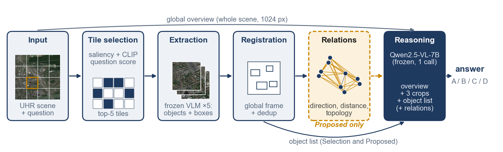
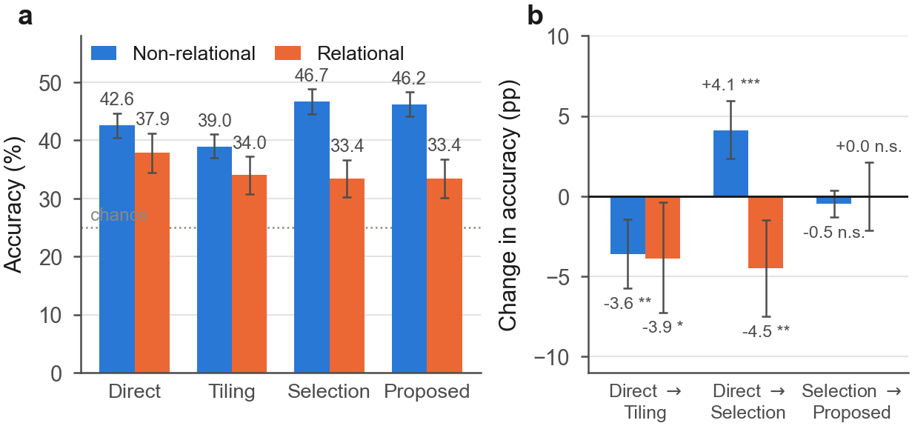
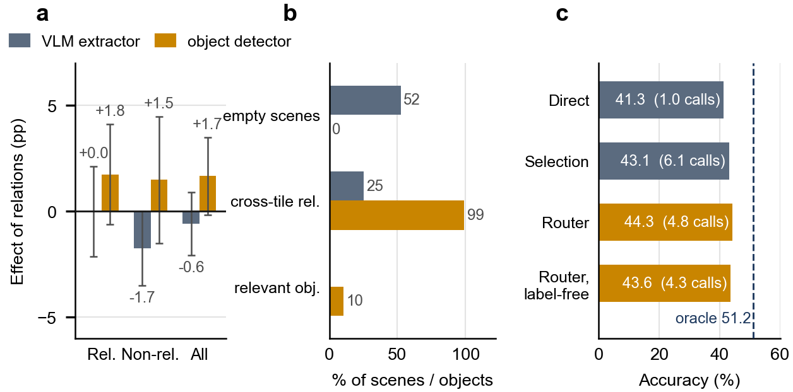
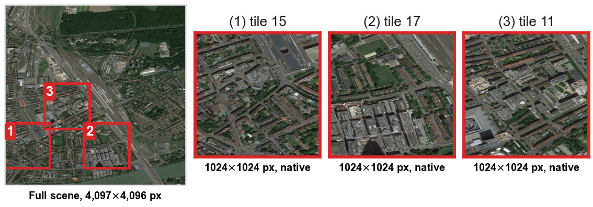
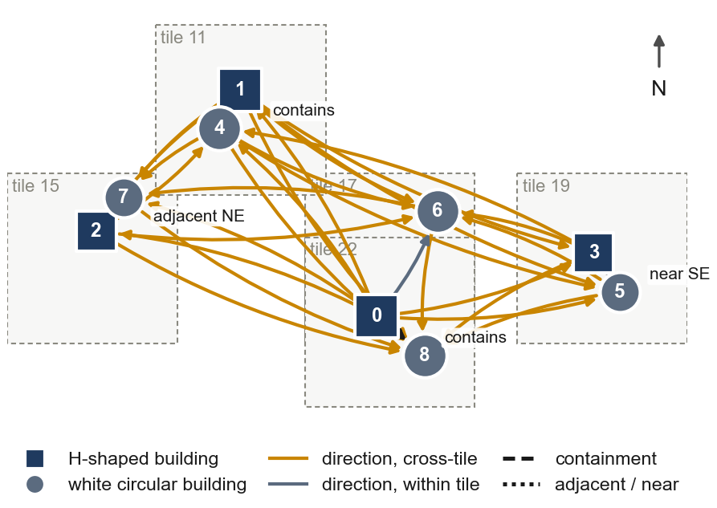

<div align="center">

# Resolution Without Relations

**Quantifying the perception–reasoning trade-off of tile selection in ultra-high-resolution remote sensing VQA**

[](LICENSE)
[](#data-and-licence)
[](requirements.txt)
[](https://pytorch.org)
[](https://huggingface.co/docs/transformers)
[](https://huggingface.co/Qwen/Qwen2.5-VL-7B-Instruct)
[](https://huggingface.co/IDEA-Research/grounding-dino-base)
[](#reproduce-the-analysis-no-gpu-2-minutes)
[](#reproduce-the-runs-gpu)

</div>

Zooming into question-relevant tiles of an ultra-high-resolution (UHR) scene is the standard recipe
for UHR visual question answering. This repository measures what it costs. On XLRS-Bench-lite with
Qwen2.5-VL-7B-Instruct, selecting tiles **improves perception accuracy and degrades spatial
relational accuracy**, and handing the lost layout back to the model as an explicit relation graph
**does not recover it** — not even when an open-vocabulary detector fills in the objects the graph
was missing.

Every per-item model output is committed here, so all tables, figures and reported numbers rebuild
offline in about two minutes, without a GPU and without the benchmark images.

## Method

<div align="center"></div>

Four methods are compared. **Direct** encodes the whole scene in one call. **Tiling** answers on
every grid tile independently and reconciles by a text-only vote. **Selection** scores tiles against
the question and answers on the top-5 at native resolution. **Proposed** adds one thing to
*Selection*: the objects found in those tiles are registered into a single global pixel frame,
deduplicated across tile seams, and serialised as a geometric relation graph appended to the final
prompt.

`ctsr/pipelines/hierarchical.py` is where the compute match lives: *Selection* and *Proposed* are
**the same class with `use_relations` false or true**, so the relational comparison is paired and
call-for-call identical — 6.10 VLM calls and 7.53 encoded megapixels either way.

## Findings

| Method (identical VLM, greedy decoding) | VLM calls | MPix | Overall | Relational | Non-relational |
|---|---|---|---|---|---|
| Direct (whole image, downscaled) | 1.00 | 0.98 | 41.3 | 37.9 | 42.6 |
| Tiling (all tiles, no selection) | 9.15 | 7.83 | 37.8 | 34.0 | 39.0 |
| Selection (question-relevant tiles) | 6.10 | 7.53 | **43.1** | 33.4 | **46.7** |
| Proposed (selection + relation graph) | 6.10 | 7.53 | 42.7 | 33.4 | 46.2 |

*n* = 2,983 scored four-option questions (chance 25%), 800 relational / 2,123 non-relational.

<div align="center"></div>

**1. The crossover.** Direct → Selection is **+4.1 pp** on non-relational questions (*p* = 9×10⁻⁶)
and **−4.5 pp** on relational ones (*p* = 0.004). The sign flip survives all **8** alternative
definitions of the relational group (permutation *p* ≤ 0.031).

**2. The null.** Selection → Proposed is **+0.0 pp** relational (*p* = 1.00, 95% CI [−2.1, +2.1])
under matched VLM calls and encoded pixels.

<div align="center"></div>

**3. Not an artefact of empty graphs.** With Grounding DINO supplying objects, empty scene graphs
fall from 52% to 0% and cross-tile relations rise from 25% to 99%, yet the relational gain is only
**+1.8 pp** (*p* = 0.18). The bottleneck is object **relevance**: ~10% of detected objects match a
question keyword (most frequent label: `tree`, 15,350 instances).

**4. What does help.** A cross-validated router that decides *whether* to zoom reaches **44.3%**
(**+1.2 pp** over always zooming, *p* = 0.0039) with **22% fewer** VLM calls; a label-free variant
matches accuracy at 30% fewer calls. A per-question oracle over the two policies would reach 51.2%.

<table>
<tr>
<td width="50%"></td>
<td width="50%"></td>
</tr>
<tr>
<td align="center"><em>One scene as the pipeline sees it: selected tiles in context, then at native resolution.</em></td>
<td align="center"><em>The relation graph built for it; 27 of its 32 relations span tile boundaries.</em></td>
</tr>
</table>

## Layout

```
ctsr/                 the pipeline package
  data/               XLRS-Bench loading, task taxonomy, answer parsing
  spatial/            tile geometry, pairwise relations, scene-graph serialisation
  pipelines/          direct / tiling / hierarchical (Selection and Proposed share one class)
  prompts/            the exact prompt templates used in every arm
configs/              YAML configs; configs/main.yaml reproduces the reported run
scripts/              00..06, run in order; see "Reproduce" below
analysis/             analyse committed outputs -> tables, figures, LaTeX macros
figures/              every figure in the paper, as vector PDF and 300-dpi PNG
notebooks/            single-notebook version of the pipeline
tools/                figure helpers and the real benchmark questions used as examples
results/main/         the reported run: 4 arms x 3,080 per-item records (gzipped) + report tables
results/detector_grounding/  the detector-grounded experiment: 1,201 items x 2 arms
results/analysis_outputs/    everything the analysis scripts regenerate
```

## Reproduce the analysis (no GPU, ~2 minutes)

```bash
pip install numpy scipy matplotlib pandas scikit-learn pyyaml
python scripts/prepare_results.py          # gunzip predictions.jsonl.gz in place
python analysis/analyze.py --results results/main --out analysis
python analysis/make_figures.py            # the main and appendix figures
python analysis/run_all.py                 # robustness, power, router, detector analysis, macros
```

or simply `make analysis`.

`analysis/run_all.py` runs `r01`…`r07` in order and writes to `results/analysis_outputs/`:

| script | what it establishes |
|---|---|
| `r01_partition_robustness.py` | the crossover under 8 definitions of "relational" |
| `r02_null_power.py` | minimum detectable effect at 80% power (3.0 pp relational, 6.9 pp crossover) |
| `r03_router.py` | cross-validated router, 5 folds × 20 repeats, plus the label-free variant and the oracle |
| `r04_router_figure.py` | router accuracy/cost figure |
| `r05_detector_grounding.py` | detector-grounded arms, graph statistics, label-relevance analysis |
| `r06_grounding_figure.py` | grounding figure |
| `r07_paper_assets.py` | `numbers_rev.tex` (93 macros), `table_partitions.tex`, `fig3` |

No reported number is typed by hand: the manuscript reads `numbers.tex` and `numbers_rev.tex`, both
generated here. Regenerating them and diffing against the committed copies is the fastest way to
check any claim in the paper.

## Reproduce the runs (GPU)

The reported run took **35.6 GPU-hours** on one NVIDIA L40S (44 GB), plus **4.2 GPU-hours** for the
detector-grounded experiment. Environment of record: Python 3.11.5, torch 2.13.0+cu130,
transformers 4.57.6, CUDA 13.0.

```bash
# 1. torch first, matched to your CUDA build (see requirements.txt), then:
pip install -r requirements.txt
python scripts/00_check_env.py --load-model      # verifies Qwen2.5-VL loads

# 2. data: XLRS-Bench-lite from HuggingFace (initiacms/XLRS-Bench-lite), cached under data/
python scripts/01_prepare_data.py --config configs/main.yaml

# 3. the four arms (resumable; re-running skips finished items)
python scripts/02_run_experiment.py --config configs/main.yaml --arm b1_direct
python scripts/02_run_experiment.py --config configs/main.yaml --arm b2_tiling
python scripts/02_run_experiment.py --config configs/main.yaml --arm b3_selected
python scripts/02_run_experiment.py --config configs/main.yaml --arm proposed_ctsr

# 4. tables and qualitative cases
python scripts/03_aggregate_results.py --results results/main
python scripts/04_qualitative.py --results results/main

# 5. the detector-grounded experiment (downloads Grounding DINO base)
python scripts/06_detector_grounding.py --results results/main --out results/detector_grounding
```

`configs/low_vram.yaml` runs the same protocol with 4-bit weights; `configs/smoke.yaml` uses the
stub backend and needs no GPU, which is the cheapest way to check the compute match (both
hierarchical arms report identical VLM calls and encoded pixels).

Decoding is greedy with a fixed seed, but generation on a different GPU, transformers version or
attention kernel will not be bit-identical. Expect small per-item differences; the reported effects
are 4–6 pp with the confidence intervals given above.

## Technologies

| Layer | What is used |
|---|---|
| VLM | [Qwen2.5-VL-7B-Instruct](https://huggingface.co/Qwen/Qwen2.5-VL-7B-Instruct), bf16, greedy, 1,280 visual tokens |
| Detector | [Grounding DINO base](https://huggingface.co/IDEA-Research/grounding-dino-base), open-vocabulary, box/text thresholds 0.30 / 0.25 |
| Tile scoring | gradient + variance saliency and [CLIP](https://github.com/openai/CLIP) question–tile similarity (0.35 / 0.65) |
| Runtime | PyTorch 2.13 + CUDA 13.0, HuggingFace Transformers 4.57, `qwen-vl-utils` |
| Statistics | McNemar exact tests, 10,000-sample paired bootstrap, permutation tests, Holm correction (SciPy/NumPy) |
| Router | scikit-learn logistic regression, 5-fold × 20-repeat cross-validation |
| Figures | Matplotlib, vector PDF with embedded TrueType fonts, colour-vision-deficiency-safe palette |
| Benchmark | [XLRS-Bench-lite](https://arxiv.org/abs/2503.23771) (CVPR 2025), 3,080 four-option items |

## Data and licence

- **Code** in this repository: MIT (see [LICENSE](LICENSE)).
- **Benchmark.** Images and annotations come from [XLRS-Bench](https://arxiv.org/abs/2503.23771)
  (CVPR 2025) and are *not* redistributed here. Its annotations are released under CC BY-NC-SA;
  obtain them from the authors' release and follow its terms. `results/` contains our model outputs
  (predicted option letters, token counts, timings, geometry and scene graphs) plus the question
  ids needed to join back to the benchmark.
- **Models.** Qwen2.5-VL-7B-Instruct and Grounding DINO base are downloaded from HuggingFace under
  their own licences; no weights are included here.
- 97 of the 3,080 loaded questions are excluded from scoring because the *Overall Land Use* category
  is multi-select rather than four-option; the exclusion is recorded in the coverage section of
  `results/main/report/aggregate.json`.

## Citation

```bibtex
@inproceedings{resolutionwithoutrelations,
  title     = {Resolution Without Relations: Quantifying the Perception--Reasoning
               Trade-off of Tile Selection in Ultra-High-Resolution Remote Sensing},
  author    = {TODO},
  booktitle = {Computer Vision Conference (CVC)},
  year      = {2027}
}
```
