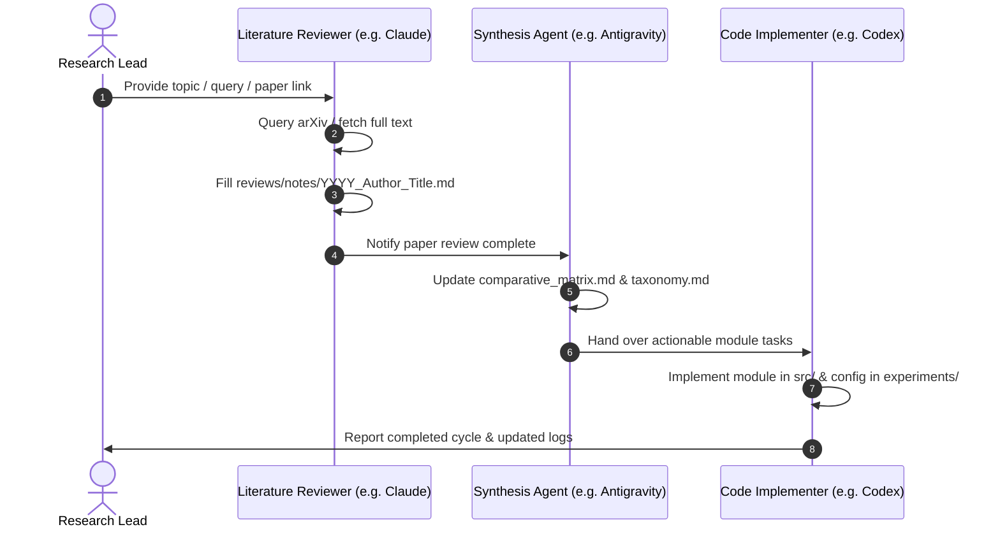

# Multi-Agent Workflow: Literature Research Pipeline

This workflow coordinates agents through the end-to-end process of reading, analyzing, synthesizing, and translating research papers into code.

---

## Process Flow

---

## Step-by-Step Execution Guide

### 1. Ingestion
- Retrieve paper via `skills/search_and_fetch/` or science skills (`literature-search-arxiv`, `literature-search-openalex`).
- Add entry to [`papers/bibliography.bib`](file:///d:/projects/research/vlm/papers/bibliography.bib).
- Store full extracted content in `papers/extracted/[key].md`.

### 2. Deep Analysis
- Duplicate [`reviews/template.md`](file:///d:/projects/research/vlm/reviews/template.md) to `reviews/notes/[YYYY]_[FirstAuthor]_[Topic].md`.
- Populate every section thoroughly, paying particular attention to **Relevance (1-5)**, **What It Adds vs. What It Doesn't**, and **Prior Art Overlap**.

### 3. Cross-Paper Synthesis
- Insert row into [`findings/comparative_matrix.md`](file:///d:/projects/research/vlm/findings/comparative_matrix.md).
- Update [`findings/taxonomy.md`](file:///d:/projects/research/vlm/findings/taxonomy.md) if a new architectural component was introduced.
- Log completion in [`findings/research_log.md`](file:///d:/projects/research/vlm/findings/research_log.md).

### 4. Implementation & Validation
- Implement candidate module in `src/models/` or `src/data/`.
- Add test script or experiment config in `experiments/configs/`.
