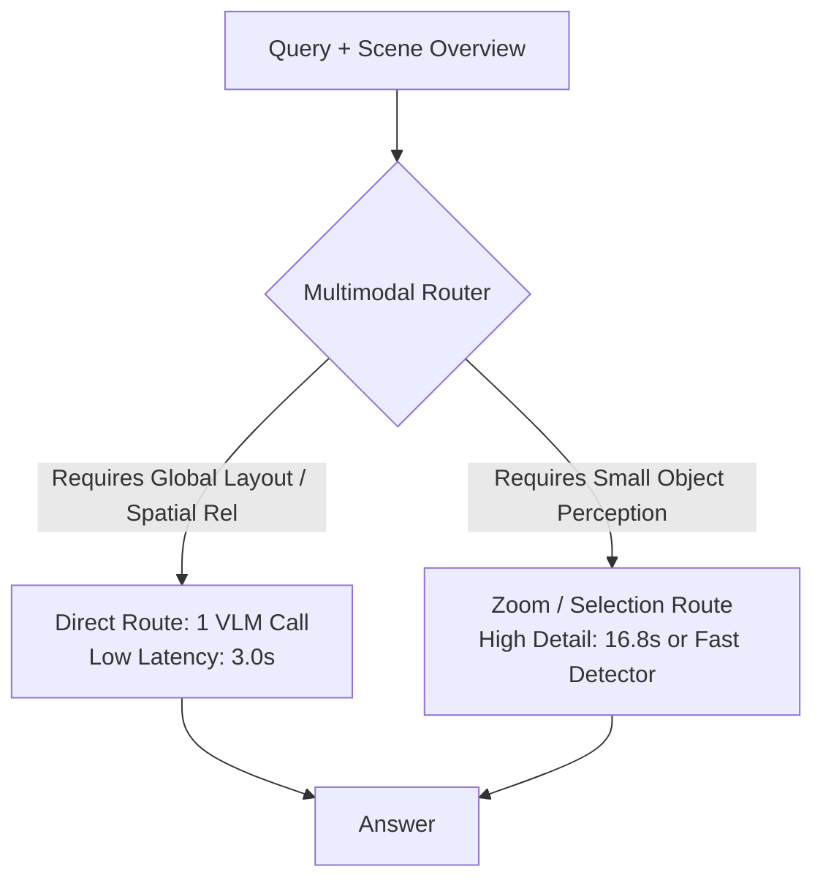

# Multimodal Routing & The Oracle Potential

One of the most consequential findings in the RwR paper is the extreme complementarity between the **Direct** baseline (whole scene) and the **Selection** pipeline (zoomed crops). This document outlines the quantitative potential and design principles of an intelligent router.

---

## 1. The Complementarity Matrix

Direct and Selection do not fail on the same items:
- There are items where **Direct succeeds** (because the question relies on global layout, cardinal directions across the whole scene, or wide contextual patterns) while **Selection fails** (because it zoomed into the wrong crop or cut off the reference object).
- There are items where **Selection succeeds** (because the question asks about a 30-pixel roof color, vehicle count, or fine texture) while **Direct fails** (because downsampling erased the evidence).

### Performance Comparison

| Strategy | VLM Calls | Latency | Relational Acc | Non-Relational Acc | Overall Acc |
| :--- | :---: | :---: | :---: | :---: | :---: |
| **Direct Only** | 1.0 | 3.0s | **37.9%** | 42.6% | 41.3% |
| **Selection Only** | 6.1 | 16.8s | 33.4% | **46.7%** | 43.1% |
| **Oracle Router** (Direct $\cup$ Selection) | 1.0 - 6.1 | ~8.0s | **44.9%** | **53.6%** | **51.2%** |

$$\text{Oracle Gain} = 51.2\% - 43.1\% = \mathbf{+8.1\text{ pp}}$$

---

## 2. Computational Latency Analysis

The runtime profile of Selection demonstrates severe waste:
- **Global Overview**: 2.6s
- **Tile Scoring (CLIP + Saliency)**: 0.3s
- **Local Extraction (5 VLM calls)**: **13.0s (77.4% of total runtime)**
- **Final Answer Generation**: 0.9s
- **Total Selection Runtime**: **16.8s per item**

When an item can be resolved directly by the global overview:
- Skipping local extraction saves **13.0s to 13.8s per query** ($>80\%$ time reduction).
- Eliminates the $-4.5\text{ pp}$ spatial relation penalty.

---

## 3. Router Design Paradigms to Investigate

### Proposed Router Architectures:
1. **Text-Only Question Classifier**:
   - A fast transformer (e.g., ModernBERT, DeBERTa-v3-small) trained on question embeddings and task category priors.
   - Inference latency: $<10\text{ ms}$.
2. **Coarse-Visual + Text Cross-Attention Router**:
   - Compares question embeddings against the global CLIP embedding of the scene and its spatial frequency energy.
   - If question refers to fine-grained visual attributes (e.g. "color of car", "license plate", "window count") $\rightarrow$ trigger Zoom.
   - If question refers to global topology (e.g. "which direction is X relative to Y across the town") $\rightarrow$ trigger Direct.
3. **Cascaded Confidence-Based Router**:
   - Always run Direct first (3.0s).
   - If output token entropy / confidence is high $\rightarrow$ return answer immediately.
   - If confidence is low or model signals visual ambiguity $\rightarrow$ escalate to Zoom.
