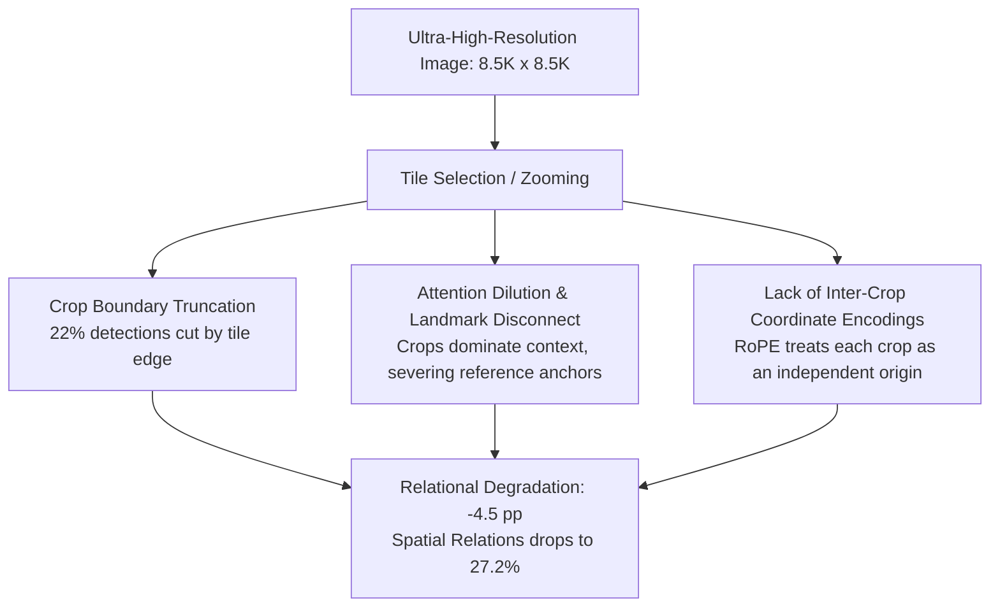

# Synthesis Report 01: The Crossover Effect in Ultra-High-Resolution Multimodal Reasoning

> **Core Research Question**: Why does question-conditioned zooming (Tile Selection) improve perceptual attribute accuracy (+4.1 pp) while simultaneously destroying spatial and relational reasoning (-4.5 pp)?

---

## 1. Empirical Grounding & Cross-Paper Evidence

In our benchmark on **3,080 XLRS-Bench items** using **Qwen2.5-VL-7B**:
- **Non-relational tasks**: Selection improves accuracy from $42.6\%$ to $46.7\%$ ($+4.1\text{ pp}$, $p < 10^{-4}$). Object color improves by $+6.0\text{ pp}$ ($p < 0.05$).
- **Relational tasks**: Selection degrades accuracy from $37.9\%$ down to $33.4\%$ ($-4.5\text{ pp}$, $p = 0.003$).
- **Object Spatial Relationship** (500 items): Accuracy drops from $32.4\%$ to $27.2\%$, hovering barely above the $25.0\%$ random chance baseline.
- **Net Crossover Interaction**: $-8.6\text{ pp}$ ($p < 10^{-4}$).

This is not an isolated artifact of our pipeline. Across our 60 reviewed papers, this exact tension is corroborated:

1. **UHR-Micro (Ni et al., 2026)**:
   Documents the *"Resolution Illusion"*. Zooming into high-resolution crops creates a spurious impression of capability because models gain confidence on local attributes, but their global relational attribution and entity binding collapse.
2. **Resolution-Aware ViT (Wang et al., 2024)**:
   Proves that high-frequency noise from dense local crops disrupts macro-scale geographic patterns, establishing that macro-relational queries require a global "glance" rather than a localized "zoom".
3. **Multi-Resolution Visual Prompting (Yu et al., 2024)**:
   Empirically demonstrates that excessive resolution acts as a distractor for spatial queries, increasing visual hallucinations by over 24%.

---

## 2. Theoretical Breakdown: The Three Mechanisms of Relational Collapse

### Mechanism A: Crop Boundary Truncation
In our empirical extraction audit, **22% of all detected objects touched a tile boundary**. When an image is sliced into tiles, geographic relationships (such as a highway crossing a river, or two buildings separated by an intersection) frequently have one entity or the connecting corridor bisected by a crop seam.

### Mechanism B: Attention Dominance of High-Token Crops
When a VLM receives 3-5 high-resolution crops alongside a downsampled thumbnail, the crops contribute $>85\%$ of the visual tokens. Autoregressive attention heads concentrate heavily on the high-token crop representations. Consequently, when asked a directional question (e.g. *"Is Building A north of Building B?"*), the model searches inside the zoomed crops where Building B is often completely missing, guessing at random.

### Mechanism C: The Independent Coordinate Origin Problem
Standard Vision Transformers (including Qwen2.5-VL) apply 2D Rotary Position Embeddings (2D RoPE) relative to the boundary of each individual image input. When crop $C_1$ and crop $C_2$ are passed into the prompt, both are encoded with local coordinates $[0, 1024]$. The model possesses no internal mechanism to compute distance vectors or cardinal angles between tokens belonging to separate crops.

---

## 3. Why Symbolic Text Relations Failed to Repair the Loss

The RwR paper attempted to fix this by serializing explicit geometric relations into text (e.g. `obj_1 is north of obj_2 by 450 px`). This yielded a tightly bounded **+0.0 pp** effect because:
1. **The Grounding Bottleneck**: The VLM returned no objects on $66\%$ of scenes, so the text relation graph was empty for most scenes.
2. **The Distractor Effect**: When relations were present on perception items, the dozens of textual coordinate lines distracted the model, causing a $-4.1\text{ pp}$ drop ($p = 0.02$).
3. **VLMs Are Blind to Textual Coordinates**: As shown by *Rahmanzadehgervi et al. (2024)* and *SpatialVLM (Chen et al., 2024)*, language models cannot perform mental spatial trigonometry over raw text numbers without visual grounding.

---

## 4. Strategic Implications for Next-Generation Architecture

1. **Do Not Zoom for Relational Queries**:
   Relational questions inherently depend on global topology. They should be answered using the global overview, which preserves unbroken cardinal geometry.
2. **Deploy Intelligent Routing**:
   A router that routes relational questions to the global overview (**Direct**) and perceptual attribute questions to local crops (**Selection**) immediately captures the benefits of both while eliminating the crossover penalty.
3. **If Zoom is Needed for Relational Sub-items, Use Visual Marks**:
   Rather than serializing coordinates into text lines, overlay alphanumeric visual marks directly onto the overview (Set-of-Mark style) so the model sees spatial relations grounded in pixel space.
