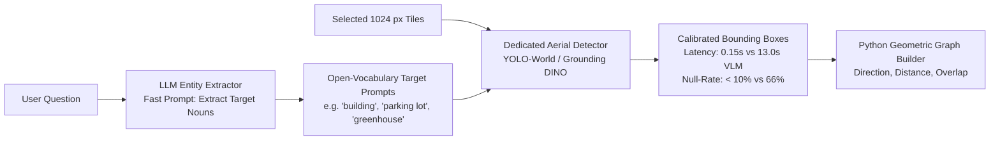

# Synthesis Report 02: The Grounding Bottleneck — Zero-Shot VLMs vs. Dedicated Detectors

> **Core Research Question**: Why did zero-shot VLM prompting fail as an object extractor (66% null objects), and how can dedicated open-vocabulary detectors (YOLO-World, Grounding DINO) resolve this bottleneck?

---

## 1. The Breakdown of Zero-Shot VLM Grounding

In the RwR baseline pipeline, object detection was executed by prompting `Qwen2.5-VL-7B-Instruct` zero-shot to inspect selected tiles and emit JSON bounding boxes:
$$\text{Tile} \xrightarrow{\text{Qwen2.5-VL Prompt}} [\{\text{"label": str, "box": } [y_1, x_1, y_2, x_2]\}]$$

### Empirical Audit Results (Table 2 & Appendix A.4 in `main.pdf`)
- **Overall Failure Rate**: Across all 3,080 test scenes, the VLM returned **zero parseable objects on 66% of scenes**.
- **Perception Tasks Failure**:
  - *Object Colour*: **100% of scenes returned 0 objects**.
  - *Object Motion State*: **100% of scenes returned 0 objects**.
  - *Object Classification*: **98% of scenes returned 0 objects**.
- **Relational Tasks Failure**:
  - *Regional Counting*: 49% had 0 objects.
  - *Complex Counting*: 48% had 0 objects.
  - *Spatial Relationship*: 37% had 0 objects.
- **Cross-Tile Relations**: Only **21% of scenes** produced any cross-tile edges.

### Why Did This Happen?
1. **Resolution Mismatch for Pre-trained Coordinate Heads**:
   General-domain VLMs (like Qwen2.5-VL) are pre-trained on natural photographic datasets (COCO, RefCOCO, Visual Genome) where objects typically occupy $10\%$ to $40\%$ of the image canvas. In satellite crops, targets are tiny ($10$ to $50$ pixels), with dense textures and overhead nadir geometry.
2. **Conservative Generation Thresholds**:
   When prompted to output bounding boxes for small, ambiguous targets, autoregressive language models default to emitting empty responses `[]` rather than risking hallucinated coordinates.
3. **Question Verbatim Mimicry**:
   When the VLM did output labels, it copied the query text into the label name (e.g., labeling an entity as `"the building with the red pyramid roof to the parking lot on the left"`), creating noisy, non-generalizable node labels.

---

## 2. Cross-Literature Evidence: Zero-Shot VLMs vs. Dedicated Detectors

| Dimension | Zero-Shot VLM Prompting (Qwen2.5-VL) | Dedicated Open-Vocabulary Detectors (Grounding DINO / YOLO-World) |
| :--- | :--- | :--- |
| **Output Type** | Autoregressive text JSON | Direct bounding box regression $[x_1, y_1, x_2, y_2]$ + confidence score |
| **Parsing Failure Risk** | Susceptible to syntax errors, markdown fences | Zero syntax risk (native tensor outputs) |
| **Small Object Sensitivity**| Very weak ($<32\text{ px}$ targets missed $98\%$ of the time) | High recall via multi-scale Feature Pyramid Networks (FPN) |
| **Inference Latency** | **2,600 ms** per crop ($13.0\text{s}$ for 5 crops) | **15 ms – 40 ms** per crop ($<0.2\text{s}$ for 5 crops) |
| **Confidence Calibration** | Soft language generation logits (uncalibrated) | Sigmoid classification scores calibrated on objectness |
| **Oriented Geometry** | Axis-aligned only (AABB) | Supports Rotated / Oriented bounding boxes (OBB) |

### Key Literature Corroboration:
- **Grounding DINO (Liu et al., 2024)**: Demonstrates that bi-directional cross-attention feature enhancement between text tokens and visual feature maps provides orders-of-magnitude higher small-object recall than autoregressive language decoders.
- **YOLO-World (Cheng et al., 2024)**: Proves that re-parameterizing text embeddings into convolutional/PANet weights enables open-vocabulary detection in $<20\text{ ms}$ per image.
- **DetGPT (Pi et al., 2023)**: Proves that the optimal division of labor is: **LLM reasons about what to detect $\rightarrow$ Dedicated detector localizes coordinates $\rightarrow$ LLM synthesizes the final answer**.

---

## 3. The New Grounding Architecture

### Expected Quantitative Impact
1. **Null Graph Elimination**: Dropping the null-object scene rate from $66\%$ to $<10\%$.
2. **Massive Latency Reduction**: Slashing extraction time from **13.0s** down to **~0.15s** (an **85x acceleration** in extraction compute).
3. **True Test of the Relational Hypothesis**: With $90\%+$ of scenes having valid, noise-free object coordinates, we can finally determine the true upper bound of cross-tile geometric reasoning.
