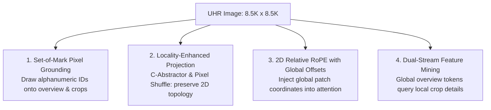

# Synthesis Report 04: Cross-Scale Topology Preservation in Multimodal Reasoning

> **Core Research Question**: When zooming is mandatory, how can multi-scale visual tokens and inter-crop spatial geometry be preserved without flooding token budgets or causing relational collapse?

---

## 1. The Core Geometric Dilemma

In ultra-high-resolution vision-language models, the fundamental challenge is connecting micro-scale visual features (individual buildings, vehicles, road markings) to macro-scale geographic topology (cardinal directions, town layouts, water flow vectors).

Standard approaches fail at two extremes:
1. **Aggressive Downscaling**: Collapses micro-scale features into single pixel blurs.
2. **Text Serialization of Geometry**: Serializing coordinates into strings (`obj_1 at [230, 450] is north of obj_2 at [230, 890]`) floods the context with unstructured numerical noise that language models cannot internalize (*SpatialVLM, 2024; VLMs are Blind, 2024*).

---

## 2. Four Viable Paradigms from Literature

Synthesizing our 60 reviewed papers, four concrete architectural paradigms emerge for preserving topology across scales:

### Paradigm 1: Set-of-Mark (SoM) Pixel Grounding (*Yang et al., Microsoft 2023*)
- **Mechanism**: Instead of serializing coordinates into text tokens, overlay visually distinct colored bounding boxes with bold alphanumeric IDs (`[1]`, `[2]`, `[A]`, `[B]`) directly onto the global overview and local crops before image encoding.
- **Why It Works**: Vision Transformers process visual marks through their native attention heads. The model can see the spatial relationship between `[1]` and `[2]` in the overview image, while resolving fine-grained attributes in the crop labeled `[1]`.
- **Relational Impact**: Eliminates coordinate text hallucination completely.

### Paradigm 2: Locality-Preserving Token Downsampling (*Honeybee / InternVL*)
- **Mechanism**: Replace standard 1D linear projection or permutation-invariant resamplers with **Pixel Shuffle (2x2)** or **C-Abstractor** (depthwise separable 2D convolutions).
- **Why It Works**: 2D convolutions enforce spatial continuity. Adjacent tokens in image space remain adjacent in feature space, preserving physical boundaries (coastlines, roads, fences) across tile seams.
- **Efficiency Impact**: Cuts visual token count by $4\times$ ($75\%$ token reduction) with zero loss of spatial resolution.

### Paradigm 3: 2D Relative Positional Encodings with Global Offsets (*NaViT / SpaceLLM*)
- **Mechanism**: When encoding crop $C_k$ located at global offset $(X_k, Y_k)$, pass the global offset coordinates to the vision rotary positional embedding (2D RoPE):
  $$\text{RoPE}(x, y) = \text{RoPE}(X_k + x_{\text{local}}, Y_k + y_{\text{local}})$$
- **Why It Works**: All tokens from all crops and the overview share a single, unified Euclidean coordinate frame. Self-attention heads can directly compute Euclidean dot-product distance and cardinal direction between any two tokens in the sequence.

### Paradigm 4: Dual-Stream Cross-Attention Patch Mining (*Mini-Gemini / SkySense*)
- **Mechanism**: Use the low-resolution global overview tokens as query vectors to attend over high-resolution local crop tokens.
- **Why It Works**: Global tokens act as semantic anchors, ensuring that high-resolution details are merged into their appropriate geographic positions without increasing the overall sequence length.

---

## 3. Recommended Implementation Roadmap for This Codebase

1. **Step 1 (Immediate)**: Implement Set-of-Mark visual annotation in `ctsr/spatial/visual_marks.py`: draw labeled boxes on candidate crops and pass annotated images to the final VLM call.
2. **Step 2 (Short-term)**: Integrate Pixel Shuffle 2x2 spatial downsampling into `src/models/projectors.py` to reduce crop token overhead from 1,280 down to 320 tokens per crop.
3. **Step 3 (Medium-term)**: Inject global coordinate offsets into Qwen2.5-VL 2D RoPE positional embeddings.
