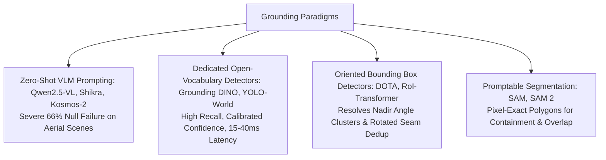

# VLM Multi-Dimensional Taxonomy for Ultra-High-Resolution Reasoning

A comprehensive classification of paradigms across the 60 reviewed papers, structured across the four key engineering dimensions of this project.

---

## 1. Dimension 1: Multi-Scale Resolution & Tiling Paradigms

```mermaid
graph TD
    RES[Resolution Paradigms]
    RES --> GLO[Global Downscaling: Direct (1 call, 0.98 MPix)]
    RES --> UNI[Uniform Grid Tiling: Monkey, LLaVA-NeXT, DC2]
    RES --> ACT[Active / Selective Zoom: ZoomEarth, ZoomEye, V*, ImageRAG]
    RES --> DYN[Native Variable Resolution: NaViT, Qwen2.5-VL]
    RES --> DUA[Dual-Stream Cross-Scale: Mini-Gemini, SkySense]
```

- **Global Downscaling (Direct)**: Compresses image to fit standard VLM input ($1024 \times 1024$). Preserves global spatial topology and cardinal relationships, but erases targets smaller than 50 pixels.
- **Uniform Grid Tiling (Monkey, LLaVA-NeXT, DC2)**: Partitions image into regular crops (e.g. $3 \times 3$, $8 \times 8$). Causes quadratic token growth and severe crop-edge bisections ($22\%$ in aerial imagery).
- **Active / Selective Zoom (ZoomEarth, ZoomEye, ImageRAG, RwR Selection)**: Employs saliency, CLIP, or RL to select top-$k$ informative tiles. Boosts perception (+4.1 pp) but destroys cross-tile relational context (-4.5 pp).
- **Dual-Stream Cross-Scale (Mini-Gemini)**: Keeps a low-resolution overview as anchor queries while attending to high-resolution detail tokens.

---

## 2. Dimension 2: Grounding & Entity Localization Paradigms



- **Zero-Shot Autoregressive VLM Prompting**: Asking a frozen VLM to generate text bounding boxes `[y1, x1, y2, x2]`. Fails on small aerial objects ($66\%$ null rate) and introduces $13.0\text{s}$ latency.
- **Dedicated Open-Vocabulary Detectors (Grounding DINO, YOLO-World)**: High-speed, high-recall localization conditioned on open-ended text. Operates in $<20\text{ms}$ per crop with calibrated confidences.
- **Oriented Aerial Detectors (DOTA-v2, RoI Transformer)**: Predicts rotated boxes $(x, y, w, h, \theta)$, preventing false overlap in dense aerial formations (airports, harbors, diagonal buildings).
- **Foundation Segmentation (SAM 2)**: Provides sub-10ms boundary delineations for exact polygon containment and road/river intersection tests.

---

## 3. Dimension 3: Spatial Topology & Relational Representation Paradigms

```mermaid
graph TD
    REL[Spatial Representation Paradigms]
    REL --> TXT[Text Coordinate Serialization: Shikra, RwR Relation Block<br/>Ignored or Acts as Distractor (-4.1 pp)]
    REL --> SOM[Set-of-Mark Pixel Overlays: SoM, VisProg<br/>Grounds Attention Directly in Image Canvas]
    REL --> LOC[Locality-Preserving Projectors: C-Abstractor, Pixel Shuffle<br/>Enforces 2D Spatial Continuity During Token Downsampling]
    REL --> ROPE[2D Relative Positional Encodings: SpaceLLM, 2D RoPE<br/>Unifies Coordinates Across Overview & Crops]
    REL --> PROG[Programmatic Geometric Engines: ViperGPT, Python Code<br/>Computes Exact Euclidean Distances & Cardinal Vectors in Code]
```

- **Text Coordinate Serialization**: Serializing coordinates into natural language strings. Language models cannot perform spatial math over text numbers; acts as a distractor on perception queries.
- **Set-of-Mark (SoM) Pixel Overlays**: Overlays colored bounding boxes with bold alphanumeric IDs directly onto images. Binds language queries to pixel regions without numerical hallucination.
- **Locality-Preserving Projection (Pixel Shuffle / C-Abstractor)**: Compresses token sequence lengths by $4\times$ using 2D depthwise convolution / unshuffle, retaining spatial neighborhood adjacency.
- **Programmatic Geometric Execution (ViperGPT)**: Calculates cardinal directions, distances, and topology directly in Python code rather than asking the LLM to guess.

---

## 4. Dimension 4: Multi-Modal Routing & Cascading Paradigms

```mermaid
graph TD
    ROU[Routing Paradigms]
    ROU --> PRI[Zero-Latency Heuristic Prior: Task Category Rule<br/>Relational -> Direct | Perception -> Zoom]
    ROU --> CLS[Lightweight Text Classifier: RouteLLM, ModernBERT<br/>Predicts Direct vs Zoom from Question Tokens (<5ms)]
    ROU --> CAS[Uncertainty-Aware Cascade: FrugalVLM, CascadedVLM<br/>Direct First -> Escalate to Zoom on Low Logit Margin]
    ROU --> SPE[Speculative Drafting: Speculative Vision<br/>Draft on 1.5B VLM -> Verify on 7B Target Model]
```

- **Task Prior Heuristics**: Deterministic rules routing spatial/relational questions to Direct overview and attribute questions to Zoom. Recovers $+5.2\text{ pp}$ with zero compute.
- **Classifier Routing (RouteLLM)**: Sequence classification over question embeddings. Predicts strategy in $<5\text{ ms}$.
- **Uncertainty Cascades (FrugalVLM / CascadedVLM)**: Runs fast Direct pass first; terminates immediately if confidence is high, escalating to Zoom only when ambiguous.
- **Speculative Vision**: Accelerates autoregressive decoding by $2.5\times$ via draft models.
