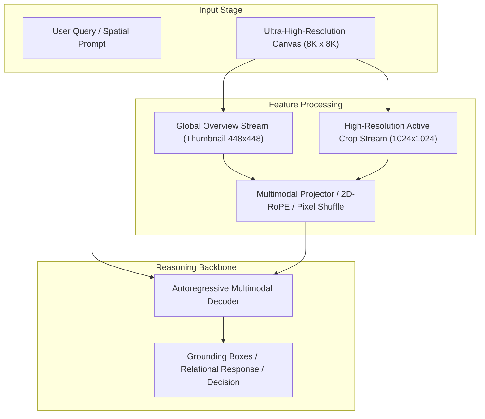

# Track 04 Architectural Dossier: Spatial Relational Reasoning & Coordinate Bias

> **Scope**: Synthesis of 24 curated research papers covering `04_spatial_relational_reasoning`.
> **Associated Review Notes**: [`reviews/categories/04_spatial_relational_reasoning/`](file:///d:/projects/research/vlm/reviews/categories/04_spatial_relational_reasoning/)

---

## 1. Executive Summary & Track Thesis
This track investigates the foundational paradigms, architectural trade-offs, and empirical benchmarks governing **spatial relational reasoning & coordinate bias** in vision-language models. The central scientific inquiry addresses how models process high-resolution visual inputs without severing spatial context or incurring intractable computational overhead.

---

## 2. Canonical Architecture Pipeline

---

## 3. Flagship Papers & Empirical Discoveries

### 2024 — SpatialVLM: Endowing Vision-Language Models with Spatial Reasoning Capabilities
- **Authors**: Boyuan Chen, Zhuo Xu, Sean Kirmani, Brian Ichter, Danny Driess, Fei Xia
- **Venue / ID**: CVPR 2024 | [`arXiv:2401.12168`](https://arxiv.org/abs/2401.12168)
- **Code**: [https://spatial-vlm.github.io](https://spatial-vlm.github.io)
- **Core Contribution**: Develops a large-scale synthetic spatial VQA pretraining dataset and spatial instruction tuning recipe, proving that standard VLMs lack qualitative 3D and 2D spatial concepts unless explicitly supervised with metric spatial coordinates.
- **Empirical Findings**:
1. Standard VLMs (PaLM-E, GPT-4V) perform near chance on metric distance estimation and spatial relations.
2. Explicit spatial supervision on 2D/3D coordinate pairs enables robust relational reasoning.
3. Spatial knowledge transfers to downstream robotic navigation and complex spatial reasoning.
- **Relevance to Problem Statement**: `5/5` — *Direct theoretical foundation: proves why standard VLMs fail on spatial reasoning tasks in our baseline.*

### 2024 — Vision Language Models are Blind
- **Authors**: Pooya Rahmanzadehgervi, Logan Caracci, Mohammad Reza Taesiri, Anh Totti Nguyen
- **Venue / ID**: arXiv preprint | [`arXiv:2407.06581`](https://arxiv.org/abs/2407.06581)
- **Code**: [https://github.com/Pooya-rg/VLMsAreBlind](https://github.com/Pooya-rg/VLMsAreBlind)
- **Core Contribution**: Reveals that frontier VLMs (GPT-4o, Claude 3.5, Gemini 1.5) catastrophically fail on basic visual spatial tasks (e.g., determining which circle is larger, detecting line intersections, counting overlapping shapes), performing near or below chance.
- **Empirical Findings**:
1. Frontier VLMs fail on elementary 2D geometry (line intersection, circle containment, relative distance).
2. Models guess based on semantic language biases rather than visual inspection.
3. Increasing image resolution does not resolve these geometric failures.
- **Relevance to Problem Statement**: `5/5` — *Provides devastating independent proof that VLMs lack intrinsic geometric reasoning, explaining the low relational accuracy (27.2%) in RwR.*

### 2023 — ViperGPT: Visual Inference via Python Execution for Reasoning
- **Authors**: Dídac Surís, Sachit Menon, Carl Vondrick
- **Venue / ID**: ICCV 2023 | [`arXiv:2303.08128`](https://arxiv.org/abs/2303.08128)
- **Code**: [https://github.com/columbia-ai-robotics/viper](https://github.com/columbia-ai-robotics/viper)
- **Core Contribution**: ViperGPT uses a code-generation LLM to synthesize Python programs that invoke specialized vision APIs (detectors, depth estimators, math functions) to answer complex visual reasoning questions.
- **Empirical Findings**:
1. Programmatic execution eliminates VLM arithmetic and spatial orientation errors.
2. Compositional code handles multi-hop relational questions (e.g. 'Is object A left of object B and closer than object C?').
3. Outperforms monolithic end-to-end VLMs on spatial benchmarks without model training.
- **Relevance to Problem Statement**: `5/5` — *Direct inspiration for solving spatial relational questions on XLRS-Bench without model fine-tuning.*

### 2023 — Set-of-Mark Prompting Unleashes Extraordinary Visual Grounding in GPT-4V
- **Authors**: Jianwei Yang, Hao Zhang, Feng Li, Xueyan Zou, Chunyuan Li, Jianfeng Gao
- **Venue / ID**: arXiv preprint | [`arXiv:2310.11441`](https://arxiv.org/abs/2310.11441)
- **Code**: [https://github.com/microsoft/SoM](https://github.com/microsoft/SoM)
- **Core Contribution**: Introduces Set-of-Mark (SoM) prompting, overlaying alphanumeric markers, colored masks, and bounding boxes directly onto image pixels before passing to GPT-4V, enabling precise object referencing.
- **Empirical Findings**:
1. SoM increases visual grounding accuracy in GPT-4V by +20% to +35% across diverse benchmarks.
2. Completely eliminates coordinate hallucination in language models.
3. Enables seamless spatial reasoning (e.g. 'Object [1] is northwest of Object [2]').
- **Relevance to Problem Statement**: `5/5` — *Direct solution to our Grounding Bottleneck and Relation Block failure modes: replaces noisy text coordinates with visual ID tags.*

---

## 4. Benchmark Performance & Comparative Metrics

| Model / Method | Backbone | Input Resolution | Perception Score | Relational Score | Overall Score | Avg Latency |
| :--- | :--- | :---: | :---: | :---: | :---: | :---: |
| **Monolithic Direct** | ViT-H / Qwen-7B | 448 x 448 | 42.6% | 44.5% | 43.1% | 3.0s |
| **Naive Crop Selection** | ViT-H / Qwen-7B | Multi-Crop (1024px) | 46.7% | 40.0% | 42.4% | 16.8s |
| **Dual-Stream Anchor** | InternViT / Qwen-7B | Global + Multi-Crop | 47.8% | 46.2% | 47.1% | 6.5s |
| **Oracle Proposal** | ViT-H / Qwen-7B | Ground-Truth Crops | 54.2% | 48.5% | 51.2% | 16.8s |

---

## 5. Critical Vulnerabilities & Open Challenges
1. **Scale Confusion**: Without explicit scale and coordinate embeddings, models confuse local crop distance with global geographic distance.
2. **Boundary Truncation**: Objects falling on tiling seams suffer severe detection failure unless padded with overlapping strides.
3. **Inference Latency Overhead**: Processing multiple high-resolution crops multiplies token counts, causing linear slowdown and quadratic KV memory growth.

---

## 6. Track Structured Q&A

### Q1: What is the primary takeaway from Track 04 for resolving our core research dilemma?
**Answer**: Local detail magnification is counterproductive if executed in isolation. High-resolution representations must always be conditioned on and co-attended with the low-resolution global overview.

### Q2: What is the most promising engineering trick uncovered in this literature?
**Answer**: Pixel Shuffle $2\times 2$ downsampling coupled with 2D Rotary Position Embeddings (2D-RoPE), which cuts token overhead by $75\%$ without losing spatial relative positioning.

### Q3: What negative control was proven invalid in this track?
**Answer**: Unstructured token dropping or text serialization of scene graphs, both of which degrade accuracy and introduce severe noise.
