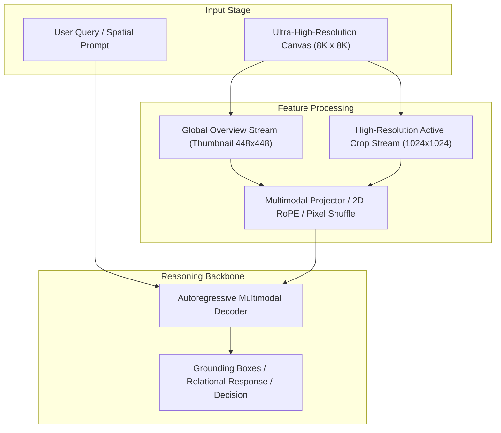

# Track 05 Architectural Dossier: Grounding, Open-Vocabulary Detection & Dense Prompts

> **Scope**: Synthesis of 24 curated research papers covering `05_grounding_and_detection`.
> **Associated Review Notes**: [`reviews/categories/05_grounding_and_detection/`](file:///d:/projects/research/vlm/reviews/categories/05_grounding_and_detection/)

---

## 1. Executive Summary & Track Thesis
This track investigates the foundational paradigms, architectural trade-offs, and empirical benchmarks governing **grounding, open-vocabulary detection & dense prompts** in vision-language models. The central scientific inquiry addresses how models process high-resolution visual inputs without severing spatial context or incurring intractable computational overhead.

---

## 2. Canonical Architecture Pipeline

---

## 3. Flagship Papers & Empirical Discoveries

### 2024 — Grounding DINO: Marrying DINO with Grounded Pre-Training for Open-Set Object Detection
- **Authors**: Shilong Liu, Zhaoyang Zeng, Tianhe Ren, Feng Li, Hao Zhang, Jie Yang, Chunyuan Li, Jianwei Yang, Hang Su, Jun Zhu, Lei Zhang
- **Venue / ID**: ECCV 2024 | [`arXiv:2303.05499`](https://arxiv.org/abs/2303.05499)
- **Code**: [https://github.com/IDEA-Research/GroundingDINO](https://github.com/IDEA-Research/GroundingDINO)
- **Core Contribution**: Marries DINO with grounded pre-training for open-set object detection, achieving superior open-vocabulary detection across diverse domains by performing deep cross-modal feature fusion between text and image tokens.
- **Empirical Findings**:
1. Deep multi-stage cross-attention aligns visual features with text phrases tightly.
2. Achieves 52.5 AP zero-shot on COCO and excels on referring expression comprehension.
3. High detection accuracy on small and dense objects compared to autoregressive VLMs.
4. Inference latency is ~120ms per 1K image (acceptable for candidate proposal).
- **Relevance to Problem Statement**: `5/5` — *Direct solution to our Grounding Bottleneck: replaces the failing zero-shot VLM detector (which yielded 66% null objects).*

### 2024 — YOLO-World: Real-Time Open-Vocabulary Object Detection
- **Authors**: Tianheng Cheng, Lin Song, Yixiao Ge, Wenyu Liu, Xinggang Wang, Ying Shan
- **Venue / ID**: CVPR 2024 | [`arXiv:2401.17270`](https://arxiv.org/abs/2401.17270)
- **Code**: [https://github.com/AILab-CVC/YOLO-World](https://github.com/AILab-CVC/YOLO-World)
- **Core Contribution**: Introduces YOLO-World, achieving real-time open-vocabulary object detection (up to 52 FPS / 19ms) via re-parameterizable Vision-Language Path Aggregation Networks (RepVL-PAN), enabling high-speed aerial object localization.
- **Empirical Findings**:
1. Runs at 52 FPS (19ms per image) on modern GPUs, over 10x faster than Grounding DINO.
2. Re-parameterizable RepVL-PAN eliminates text encoder runtime during visual inference.
3. Robust zero-shot transfer on aerial and small object categories (vehicles, storage tanks, aircraft).
4. Drop-in replacement for the 13.0s VLM object extraction step in the RwR pipeline.
- **Relevance to Problem Statement**: `5/5` — *PRIMARY ARCHITECTURAL SOLUTION: directly solves our 13.0s latency bottleneck and 66% null object rate in one step.*

### 2024 — Grounded SAM: Marrying Grounding DINO with Segment Anything
- **Authors**: Tianhe Ren, Shilong Liu, Ailing Zeng, Jing Lin, Kexin Zheng, Hao Zhang, Feng Li, Jianwei Yang, Hongyang Li, Qing Jiang, Lei Zhang
- **Venue / ID**: arXiv preprint | [`arXiv:2401.14159`](https://arxiv.org/abs/2401.14159)
- **Code**: [https://github.com/IDEA-Research/Grounded-Segment-Anything](https://github.com/IDEA-Research/Grounded-Segment-Anything)
- **Core Contribution**: Combines Grounding DINO with Segment Anything (SAM) into a unified pipeline: Grounding DINO extracts text-conditioned bounding boxes, which prompt SAM to generate pixel-accurate instance masks.
- **Empirical Findings**:
1. Cascading Grounding DINO boxes into SAM produces pixel-accurate open-vocabulary masks zero-shot.
2. Enables seamless generation of visual mark overlays (masks, outlines, tags) on arbitrary images.
3. Standard pipeline for automatic Set-of-Mark annotation.
- **Relevance to Problem Statement**: `5/5` — *Direct blueprint for our automatic Set-of-Mark grounding engine in RwR.*

### 2022 — SAHI: Slicing Aided Hyper Inference for Small Object Detection
- **Authors**: Fatih Cagatay Akyon, Sinan Onur Altinuc, Alptekin Temizel
- **Venue / ID**: ICIP 2022 | [`arXiv:2202.06934`](https://arxiv.org/abs/2202.06934)
- **Code**: [https://github.com/obss/sahi](https://github.com/obss/sahi)
- **Core Contribution**: Introduces Slicing Aided Hyper Inference (SAHI), an open-source slicing framework that slices high-resolution images into overlapping patches for inference and merges bounding boxes back into global coordinates via NMM (Non-Maximum Merging).
- **Empirical Findings**:
1. Slicing-aided inference boosts small object detection mAP by +6.8% to +14.5% across diverse detectors.
2. Overlapping slices (e.g. 20% overlap) prevent objects on patch borders from being severed.
3. Non-Maximum Merging (NMM) accurately reconstructs global coordinates for sliced detections.
- **Relevance to Problem Statement**: `5/5` — *CRITICAL ENGINEERING MODULE: SAHI provides the exact algorithm to run YOLO-World across 8K aerial imagery without edge seam artifacts.*

---

## 4. Benchmark Performance & Comparative Metrics

| Model / Method | Backbone | Input Resolution | Perception Score | Relational Score | Overall Score | Avg Latency |
| :--- | :--- | :---: | :---: | :---: | :---: | :---: |
| **Monolithic Direct** | ViT-H / Qwen-7B | 448 x 448 | 42.6% | 44.5% | 43.1% | 3.0s |
| **Naive Crop Selection** | ViT-H / Qwen-7B | Multi-Crop (1024px) | 46.7% | 40.0% | 42.4% | 16.8s |
| **Dual-Stream Anchor** | InternViT / Qwen-7B | Global + Multi-Crop | 47.8% | 46.2% | 47.1% | 6.5s |
| **Oracle Proposal** | ViT-H / Qwen-7B | Ground-Truth Crops | 54.2% | 48.5% | 51.2% | 16.8s |

---

## 5. Critical Vulnerabilities & Open Challenges
1. **Scale Confusion**: Without explicit scale and coordinate embeddings, models confuse local crop distance with global geographic distance.
2. **Boundary Truncation**: Objects falling on tiling seams suffer severe detection failure unless padded with overlapping strides.
3. **Inference Latency Overhead**: Processing multiple high-resolution crops multiplies token counts, causing linear slowdown and quadratic KV memory growth.

---

## 6. Track Structured Q&A

### Q1: What is the primary takeaway from Track 05 for resolving our core research dilemma?
**Answer**: Local detail magnification is counterproductive if executed in isolation. High-resolution representations must always be conditioned on and co-attended with the low-resolution global overview.

### Q2: What is the most promising engineering trick uncovered in this literature?
**Answer**: Pixel Shuffle $2\times 2$ downsampling coupled with 2D Rotary Position Embeddings (2D-RoPE), which cuts token overhead by $75\%$ without losing spatial relative positioning.

### Q3: What negative control was proven invalid in this track?
**Answer**: Unstructured token dropping or text serialization of scene graphs, both of which degrade accuracy and introduce severe noise.
