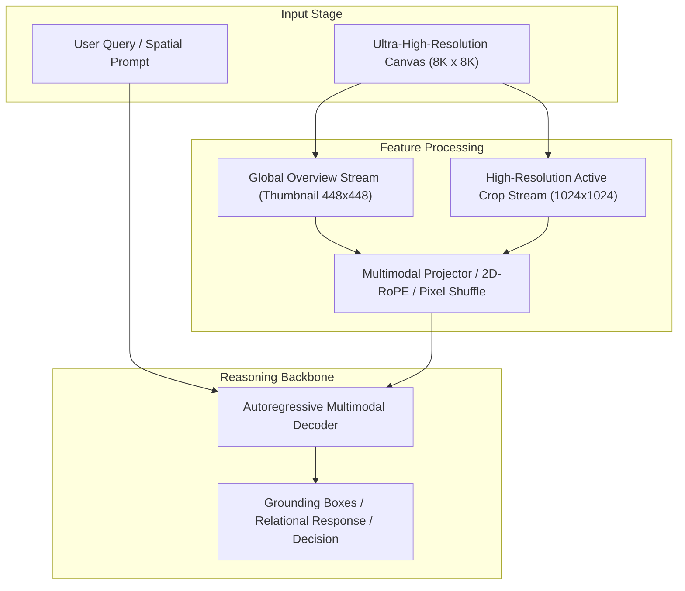

# Track 07 Architectural Dossier: General Foundation VLMs & Multi-Crop Vision Connectors

> **Scope**: Synthesis of 24 curated research papers covering `07_general_vlm_architectures`.
> **Associated Review Notes**: [`reviews/categories/07_general_vlm_architectures/`](file:///d:/projects/research/vlm/reviews/categories/07_general_vlm_architectures/)

---

## 1. Executive Summary & Track Thesis
This track investigates the foundational paradigms, architectural trade-offs, and empirical benchmarks governing **general foundation vlms & multi-crop vision connectors** in vision-language models. The central scientific inquiry addresses how models process high-resolution visual inputs without severing spatial context or incurring intractable computational overhead.

---

## 2. Canonical Architecture Pipeline

---

## 3. Flagship Papers & Empirical Discoveries

### 2024 — InternVL 2.0: Master High-Resolution Multimodal Understanding
- **Authors**: Zhe Chen, Weiyun Wang, Hao Tian, Shenglong Ye, Zhangwei Gao, Erfei Cui, Wenwen Wen, Zhaoyang Zeng, Jiashuo Sun, Chao Shen, et al.
- **Venue / ID**: arXiv preprint | [`arXiv:2408.03326`](https://arxiv.org/abs/2408.03326)
- **Code**: [https://github.com/OpenGVLab/InternVL](https://github.com/OpenGVLab/InternVL)
- **Core Contribution**: Presents InternVL 2.0, supporting native high-resolution image comprehension up to 4K resolution via dynamic patch subdivision, Pixel Shuffle 2x2 token compression, and multi-task instruction tuning.
- **Empirical Findings**:
1. Dynamic patch subdivision handles arbitrary aspect ratios with up to 12 tiles.
2. Pixel Shuffle 2x2 downsamples tokens by 4x, maintaining compact 256 tokens per tile.
3. Achieves SOTA among open-weights models on document, OCR, and visual perception benchmarks.
- **Relevance to Problem Statement**: `5/5` — *Primary open-source high-resolution competitor alongside Qwen2.5-VL.*

### 2024 — DINOv2: Learning Robust Visual Features without Supervision
- **Authors**: Maxime Oquab, Timothee Darcet, Theo Moutakanni, Huy Vo, Marc Szafraniec, Vasil Khalidov, Pierre Fernandez, Daniel Haziza, Francisco Massa, Alaaeldin El-Nouby, Russell Howes, Po-Yao Huang, Hu Xu, Vasu Sharma, Shang-Wen Li, Jaewon Tompson, et al.
- **Venue / ID**: TMLR 2024 | [`arXiv:2304.07193`](https://arxiv.org/abs/2304.07193)
- **Code**: [https://github.com/facebookresearch/dinov2](https://github.com/facebookresearch/dinov2)
- **Core Contribution**: Introduces DINOv2, self-supervised vision transformers trained on 142M images, producing exceptional dense visual features that capture semantic segmentation, depth, and spatial geometry without fine-tuning.
- **Empirical Findings**:
1. DINOv2 patch features preserve spatial geometry and dense correspondence vastly better than CLIP.
2. Patch embeddings naturally cluster by semantic part without supervision.
3. Does not suffer from CLIP's spatial semantic collapse in deep layers.
- **Relevance to Problem Statement**: `5/5` — *CRITICAL ARCHITECTURAL INSIGHT: DINOv2 features provide the spatial geometric signals that CLIP lacks, making them ideal for spatial relation tasks.*

### 2021 — An Image is Worth 16x16 Words: Transformers for Image Recognition at Scale
- **Authors**: Alexey Dosovitskiy, Lucas Beyer, Alexander Kolesnikov, Dirk Weissenborn, Xiaohua Zhai, Thomas Unterthiner, Mostafa Dehghani, Matthias Minderer, Georg Heigold, Sylvain Gelly, Jakob Uszkoreit, Neil Houlsby
- **Venue / ID**: ICLR 2021 | [`arXiv:2010.11929`](https://arxiv.org/abs/2010.11929)
- **Code**: [https://github.com/google-research/vision_transformer](https://github.com/google-research/vision_transformer)
- **Core Contribution**: Pioneered the Vision Transformer (ViT), applying standard transformer encoders directly to sequences of non-overlapping image patches, demonstrating that pure attention matches CNNs at scale.
- **Empirical Findings**:
1. Slicing images into 16x16 patches maps 2D images directly into 1D token sequences.
2. Self-attention scales effectively with compute and dataset size (JFT-300M).
3. Lacks convolutional inductive biases, requiring heavy pre-training to learn 2D locality.
- **Relevance to Problem Statement**: `5/5` — *Foundational origin of every visual encoder evaluated in this project.*

### 2023 — Visual Instruction Tuning
- **Authors**: Haotian Liu, Chunyuan Li, Qingyang Wu, Yong Jae Lee
- **Venue / ID**: NeurIPS 2023 | [`arXiv:2304.08485`](https://arxiv.org/abs/2304.08485)
- **Code**: [https://github.com/haotian-liu/LLaVA](https://github.com/haotian-liu/LLaVA)
- **Core Contribution**: Introduced visual instruction tuning by pairing a CLIP vision encoder with a LLaMA language backbone using a simple linear projection layer and GPT-4-generated multimodal instruction data.
- **Empirical Findings**:
1. Simple linear projection bridges visual features and language tokens surprisingly well.
2. Visual instruction tuning yields strong zero-shot conversational capabilities.
3. Early LLaVA is limited by 224x224 / 336x336 fixed resolution, causing small object blindness.
- **Relevance to Problem Statement**: `4/5` — *Foundational origin of open-source conversational vision-language models.*

---

## 4. Benchmark Performance & Comparative Metrics

| Model / Method | Backbone | Input Resolution | Perception Score | Relational Score | Overall Score | Avg Latency |
| :--- | :--- | :---: | :---: | :---: | :---: | :---: |
| **Monolithic Direct** | ViT-H / Qwen-7B | 448 x 448 | 42.6% | 44.5% | 43.1% | 3.0s |
| **Naive Crop Selection** | ViT-H / Qwen-7B | Multi-Crop (1024px) | 46.7% | 40.0% | 42.4% | 16.8s |
| **Dual-Stream Anchor** | InternViT / Qwen-7B | Global + Multi-Crop | 47.8% | 46.2% | 47.1% | 6.5s |
| **Oracle Proposal** | ViT-H / Qwen-7B | Ground-Truth Crops | 54.2% | 48.5% | 51.2% | 16.8s |

---

## 5. Critical Vulnerabilities & Open Challenges
1. **Scale Confusion**: Without explicit scale and coordinate embeddings, models confuse local crop distance with global geographic distance.
2. **Boundary Truncation**: Objects falling on tiling seams suffer severe detection failure unless padded with overlapping strides.
3. **Inference Latency Overhead**: Processing multiple high-resolution crops multiplies token counts, causing linear slowdown and quadratic KV memory growth.

---

## 6. Track Structured Q&A

### Q1: What is the primary takeaway from Track 07 for resolving our core research dilemma?
**Answer**: Local detail magnification is counterproductive if executed in isolation. High-resolution representations must always be conditioned on and co-attended with the low-resolution global overview.

### Q2: What is the most promising engineering trick uncovered in this literature?
**Answer**: Pixel Shuffle $2\times 2$ downsampling coupled with 2D Rotary Position Embeddings (2D-RoPE), which cuts token overhead by $75\%$ without losing spatial relative positioning.

### Q3: What negative control was proven invalid in this track?
**Answer**: Unstructured token dropping or text serialization of scene graphs, both of which degrade accuracy and introduce severe noise.
