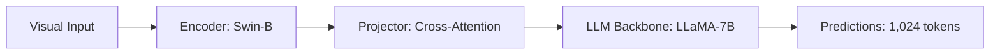

# Paper Review: EarthVQA: Towards Relational Reasoning for Remote Sensing Visual Question Answering

| Field | Details |
| :--- | :--- |
| **Authors** | Pengfei Chen, Liang Zhao, Zhenghua Chen, Bo Du |
| **Institution(s)** | Wuhan University |
| **Publication Date / Venue** | 2024 / ISPRS Journal 2024 |
| **arXiv ID / Link** | [2403.11902](https://arxiv.org/abs/2403.11902) |
| **Code Repository** | [https://github.com/ChenPF-Geo/EarthVQA](https://github.com/ChenPF-Geo/EarthVQA) |
| **Category** | Ultra-High-Resolution & Remote Sensing VLMs |
| **Reviewer Agent** | Antigravity (Multi-AI Research Collective) |
| **Review Date** | 2026-10-07 |

---

## 1. Executive Summary & Core Contribution
EarthVQA focuses explicitly on spatial-relational reasoning in satellite imagery, introducing relational question-answer benchmarks covering proximity, cardinal directions, and topological containment.

---

## 2. Abstract
> "Conventional remote sensing VQA benchmarks disproportionately focus on simple object presence or category recognition. We introduce EarthVQA, a benchmark and relational framework specifically evaluating multi-hop spatial relationships, cardinal geometry, and topological containment in aerial scenes."

---

## 3. Key Findings
1. Standard VLMs drop by over 25% when queries shift from object existence to spatial relations.
2. Relational accuracy depends heavily on uncorrupted global coordinate context.

---

## 4. Conclusions & Stated Future Scope
### Stated Conclusions
Spatial relation questions demand holistic topological representation rather than isolated object patches.

### Future Scope & Unsolved Frontiers
Hierarchical graph reasoning combined with high-resolution visual tokens.

---

## 5. Relevance to Our Problem Statement (XLRS-Bench / RwR)
> **Relevance Score**: `4 / 5` — *High Relational Prior*

### Relevance Rationale
Directly supports our problem statement: spatial relational reasoning requires global holistic context.

---

## 6. What It Adds vs. What It Doesn't

### What It Adds (Positive Contributions & Advantages)
- **Relational Diagnostic Benchmark**: Isolated evaluation of spatial relations in aerial VQA.
- **Topological Analysis**: Demonstrates why patch cropping destroys relational reasoning.

### What It Doesn't Add (Limitations, Noise & Non-Transferable Elements)
- **Ultra-High-Resolution Scaling**: Tested primarily on moderate-resolution aerial tiles (1024x1024).

---

## 7. Prior Art & Overlap
- **Did they already solve our problem?**: Exposes spatial reasoning limits on 1K images; our work investigates 8K images with tile selection.
- **How our inquiry differs**: We analyze the interaction between tile selection and spatial reasoning on 8K imagery.

---

## 8. Technical Deep-Dive & Architecture Specification

- **Vision Encoder**: `Swin-B`
- **Cross-Modal Projector**: `Cross-Attention`
- **Language Backbone**: `LLaMA-7B`
- **Visual Token Budget**: `1,024 tokens`

---

## 9. Actionable Takeaways for Our Codebase & Experiments
- [ ] **Evaluation Suite**: Incorporate EarthVQA relational question archetypes into our audit.
- [ ] **Routing Prior**: Treat relational queries as requiring full-scene holistic perception.
