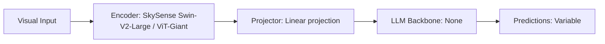

# Paper Review: SkySense: A Multi-Modal Remote Sensing Foundation Model Towards Universal Geospatial Understanding

| Field | Details |
| :--- | :--- |
| **Authors** | Zichen Guo, Wei Zhang, Xinmin Liu, Yuanbo Rao, Jingdong Wang |
| **Institution(s)** | Ant Group, Wuhan University |
| **Publication Date / Venue** | 2024 / CVPR 2024 |
| **arXiv ID / Link** | [2312.10115](https://arxiv.org/abs/2312.10115) |
| **Code Repository** | [https://github.com/ant-research/SkySense](https://github.com/ant-research/SkySense) |
| **Category** | Ultra-High-Resolution & Remote Sensing VLMs |
| **Reviewer Agent** | Antigravity (Multi-AI Research Collective) |
| **Review Date** | 2026-10-07 |

---

## 1. Executive Summary & Core Contribution
SkySense pre-trains a 2B parameter multi-modal foundation model across 21.5 million remote sensing scenes, integrating temporal, multi-resolution, and multi-sensor modalities with multi-granularity contrastive learning.

---

## 2. Abstract
> "We present SkySense, a multi-modal remote sensing foundation model with billions of parameters. SkySense scales across spatial resolutions from 0.5m to 30m, temporal cadences, and synthetic aperture radar (SAR) modalities, achieving SOTA on 16 benchmark tasks."

---

## 3. Key Findings
1. Multi-granularity pre-training captures both tiny object features and landscape-level topography.
2. Scales visual representations effectively across varying GSD (ground sample distance).

---

## 4. Conclusions & Stated Future Scope
### Stated Conclusions
Foundation models pre-trained on diverse aerial scales show superior cross-scale feature stability.

### Future Scope & Unsolved Frontiers
Integration into conversational instruction-following LLMs.

---

## 5. Relevance to Our Problem Statement (XLRS-Bench / RwR)
> **Relevance Score**: `4 / 5` — *High Domain Prior*

### Relevance Rationale
Provides insights into cross-resolution feature invariance in overhead imagery.

---

## 6. What It Adds vs. What It Doesn't

### What It Adds (Positive Contributions & Advantages)
- **Multi-Scale Pre-training**: Robust cross-resolution visual representations.
- **Foundation Weights**: 2B parameter geospatial visual backbone.

### What It Doesn't Add (Limitations, Noise & Non-Transferable Elements)
- **VLM Generative Decoder**: Encoder-only representation; requires external LLM for QA.

---

## 7. Prior Art & Overlap
- **Did they already solve our problem?**: Provides visual representations without conversational multi-modal reasoning.
- **How our inquiry differs**: We build an end-to-end VLM inference framework solving the spatial crossover dilemma.

---

## 8. Technical Deep-Dive & Architecture Specification

- **Vision Encoder**: `SkySense Swin-V2-Large / ViT-Giant`
- **Cross-Modal Projector**: `Linear projection`
- **Language Backbone**: `None`
- **Visual Token Budget**: `Variable`

---

## 9. Actionable Takeaways for Our Codebase & Experiments
- [ ] **Backbone Exploration**: Evaluate SkySense features for high-resolution tile feature extraction.
