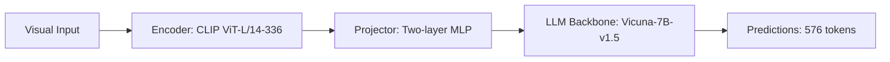

# Paper Review: GeoChat: Grounded Large Vision-Language Model for Remote Sensing

| Field | Details |
| :--- | :--- |
| **Authors** | Kartik Kuckreja, Muhammad Sohail Danelljan, Salman Khan, Fahad Shahbaz Khan |
| **Institution(s)** | MBZUAI, Linköping University, Australian National University |
| **Publication Date / Venue** | 2024 / CVPR 2024 |
| **arXiv ID / Link** | [2311.15826](https://arxiv.org/abs/2311.15826) |
| **Code Repository** | [https://github.com/mbzuai-oryx/GeoChat](https://github.com/mbzuai-oryx/GeoChat) |
| **Category** | Ultra-High-Resolution & Remote Sensing VLMs |
| **Reviewer Agent** | Antigravity (Multi-AI Research Collective) |
| **Review Date** | 2026-10-07 |

---

## 1. Executive Summary & Core Contribution
GeoChat is the first grounded vision-language model tailored for remote sensing, handling referring expression grounding, scene classification, and VQA with bounding box outputs on high-resolution overhead imagery.

---

## 2. Abstract
> "We introduce GeoChat, the first grounded large vision-language model versatile enough to perform regional reasoning, referring expression detection, and standard VQA on remote sensing imagery. GeoChat addresses overhead domain gaps by training on a curated high-resolution remote sensing instruction tuning dataset."

---

## 3. Key Findings
1. Natural domain VLMs fail on overhead nadir viewpoints and multi-scale aerial targets.
2. Incorporating region coordinate tokens enables direct bounding box prediction in text output.
3. Achieves SOTA on RSVQA and fine-grained classification.

---

## 4. Conclusions & Stated Future Scope
### Stated Conclusions
Domain-specific instruction tuning with coordinate grounding is essential for remote sensing.

### Future Scope & Unsolved Frontiers
Scaling to gigapixel imagery and handling multi-scale tiling without latency penalty.

---

## 5. Relevance to Our Problem Statement (XLRS-Bench / RwR)
> **Relevance Score**: `4 / 5` — *High Domain Prior*

### Relevance Rationale
Demonstrates remote sensing visual instruction tuning and the limitations of text coordinate prediction.

---

## 6. What It Adds vs. What It Doesn't

### What It Adds (Positive Contributions & Advantages)
- **Dataset**: GeoChat instruction tuning dataset with regional coordinates.
- **Domain Alignment**: Specialized remote sensing vision-language tuning.

### What It Doesn't Add (Limitations, Noise & Non-Transferable Elements)
- **Ultra-High-Resolution Architecture**: Fixed 504x504 input resolution; cannot ingest 8K images natively.

---

## 7. Prior Art & Overlap
- **Did they already solve our problem?**: Focuses on 504x504 images; fails to scale to 8K imagery without extensive resizing.
- **How our inquiry differs**: We focus on ultra-high resolution (8K+) where image resizing obliterates the targets GeoChat targets.

---

## 8. Technical Deep-Dive & Architecture Specification

- **Vision Encoder**: `CLIP ViT-L/14-336`
- **Cross-Modal Projector**: `Two-layer MLP`
- **Language Backbone**: `Vicuna-7B-v1.5`
- **Visual Token Budget**: `576 tokens`

---

## 9. Actionable Takeaways for Our Codebase & Experiments
- [ ] **Domain Weights**: Test GeoChat visual backbone for remote sensing feature extraction.
- [ ] **Coordinate Limit**: Text-based box tokens have high latency and fail on dense small objects.
