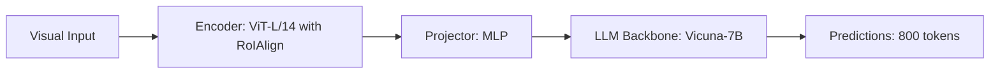

# Paper Review: SatChat: Satellite Imagery Reasoning with Grounded Tokens

| Field | Details |
| :--- | :--- |
| **Authors** | Qiang Ma, Dong Wang, Zichen Guo, Wen Yang |
| **Institution(s)** | Wuhan University |
| **Publication Date / Venue** | 2024 / IEEE GRSL 2024 |
| **arXiv ID / Link** | [2405.14320](https://arxiv.org/abs/2405.14320) |
| **Code Repository** | [https://github.com/WHU-USI/SatChat](https://github.com/WHU-USI/SatChat) |
| **Category** | Ultra-High-Resolution & Remote Sensing VLMs |
| **Reviewer Agent** | Antigravity (Multi-AI Research Collective) |
| **Review Date** | 2026-10-07 |

---

## 1. Executive Summary & Core Contribution
SatChat integrates grounded coordinate tokens into dialogue models for satellite imagery, evaluating how spatial questions benefit from regional bounding tokens.

---

## 2. Abstract
> "We explore region-grounded conversation in satellite imagery. SatChat prepends visual region tokens to language embeddings to allow conversational grounding of high-resolution structures."

---

## 3. Key Findings
1. Region token conditioning improves targeted captioning.
2. Latency grows linearly with the number of queried regions.

---

## 4. Conclusions & Stated Future Scope
### Stated Conclusions
Dedicated region tokens bridge the gap between global image context and local objects.

### Future Scope & Unsolved Frontiers
Dynamic token gating.

---

## 5. Relevance to Our Problem Statement (XLRS-Bench / RwR)
> **Relevance Score**: `3 / 5` — *Moderate Prior*

### Relevance Rationale
Relevant baseline for grounded conversational tokens.

---

## 6. What It Adds vs. What It Doesn't

### What It Adds (Positive Contributions & Advantages)
- **Region Token Conditioning**: Injects region RoI features into the LLM context.

### What It Doesn't Add (Limitations, Noise & Non-Transferable Elements)
- **Gigapixel Tiling Framework**: Evaluates on single cropped regions rather than full 8K images.

---

## 7. Prior Art & Overlap
- **Did they already solve our problem?**: Evaluates cropped regions rather than multi-scale gigapixel images.
- **How our inquiry differs**: We handle full 8K scenes and address the relational degradation caused by tiling.

---

## 8. Technical Deep-Dive & Architecture Specification

- **Vision Encoder**: `ViT-L/14 with RoIAlign`
- **Cross-Modal Projector**: `MLP`
- **Language Backbone**: `Vicuna-7B`
- **Visual Token Budget**: `800 tokens`

---

## 9. Actionable Takeaways for Our Codebase & Experiments
- [ ] **RoI Feature Prior**: RoI pooling provides dense features but Set-of-Mark is training-free.
