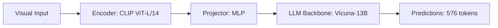

# Paper Review: LHRS-Bot: Empowering Remote Sensing with Vision-Language Models

| Field | Details |
| :--- | :--- |
| **Authors** | Diliyaer Muhtar, Zhenshi Li, Feng Gu, Xueliang Lu, Pengfeng Xiao |
| **Institution(s)** | Nanjing University |
| **Publication Date / Venue** | 2024 / IEEE TGRS 2024 |
| **arXiv ID / Link** | [2402.02544](https://arxiv.org/abs/2402.02544) |
| **Code Repository** | [https://github.com/NJU-LHRS/LHRS-Bot](https://github.com/NJU-LHRS/LHRS-Bot) |
| **Category** | Ultra-High-Resolution & Remote Sensing VLMs |
| **Reviewer Agent** | Antigravity (Multi-AI Research Collective) |
| **Review Date** | 2026-10-07 |

---

## 1. Executive Summary & Core Contribution
LHRS-Bot develops an instruction-tuned conversational agent for remote sensing using high-resolution optical and multispectral imagery with multi-level geospatial knowledge injection.

---

## 2. Abstract
> "We present LHRS-Bot, a multi-modal conversational model designed for Earth observation. LHRS-Bot incorporates hierarchical semantic descriptions and fine-grained visual features to address complex geospatial queries."

---

## 3. Key Findings
1. Multi-level geospatial prompts improve attribute recognition.
2. Hallucinations rise when small targets are not resolved in the visual input.

---

## 4. Conclusions & Stated Future Scope
### Stated Conclusions
Instruction tuning requires high-quality multi-turn geospatial conversations.

### Future Scope & Unsolved Frontiers
Active zooming and efficient token budgeting.

---

## 5. Relevance to Our Problem Statement (XLRS-Bench / RwR)
> **Relevance Score**: `3 / 5` — *Moderate Prior*

### Relevance Rationale
Exemplifies standard remote sensing instruction tuning pipelines.

---

## 6. What It Adds vs. What It Doesn't

### What It Adds (Positive Contributions & Advantages)
- **Instruction Dataset**: Curated geospatial conversational QA pairs.

### What It Doesn't Add (Limitations, Noise & Non-Transferable Elements)
- **Gigapixel Architecture**: Downscales images to standard VLM resolutions.

---

## 7. Prior Art & Overlap
- **Did they already solve our problem?**: Does not address the relational reasoning collapse in UHR.
- **How our inquiry differs**: We tackle the 8K resolution bottleneck and routing between macro/micro views.

---

## 8. Technical Deep-Dive & Architecture Specification

- **Vision Encoder**: `CLIP ViT-L/14`
- **Cross-Modal Projector**: `MLP`
- **Language Backbone**: `Vicuna-13B`
- **Visual Token Budget**: `576 tokens`

---

## 9. Actionable Takeaways for Our Codebase & Experiments
- [ ] **Data Reference**: Leverage LHRS-Bot conversation templates for prompt engineering.
