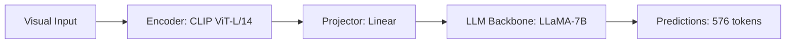

# Paper Review: SkyEyeGPT: Large Multimodal Model for Remote Sensing Vision-Language Tasks

| Field | Details |
| :--- | :--- |
| **Authors** | Yuan Zhan, Zhitong Xiong, Yuan Yuan |
| **Institution(s)** | Northwestern Polytechnical University |
| **Publication Date / Venue** | 2024 / IEEE TGRS 2024 |
| **arXiv ID / Link** | [2401.09712](https://arxiv.org/abs/2401.09712) |
| **Code Repository** | [https://github.com/NWPU-SkyEye/SkyEyeGPT](https://github.com/NWPU-SkyEye/SkyEyeGPT) |
| **Category** | Ultra-High-Resolution & Remote Sensing VLMs |
| **Reviewer Agent** | Antigravity (Multi-AI Research Collective) |
| **Review Date** | 2026-10-07 |

---

## 1. Executive Summary & Core Contribution
SkyEyeGPT develops a multimodal conversation and perception model for remote sensing, using oriented bounding box tokens to handle arbitrary object rotations in satellite imagery.

---

## 2. Abstract
> "Objects in Earth observation imagery appear in arbitrary orientations. SkyEyeGPT integrates oriented bounding box coordinates into autoregressive token generation, supporting rotated object detection and referring expression comprehension."

---

## 3. Key Findings
1. Standard horizontal bounding boxes cause massive overlap in dense aerial parking lots.
2. Oriented coordinates $(x, y, w, h, 	heta)$ improve spatial grounding in overhead images.

---

## 4. Conclusions & Stated Future Scope
### Stated Conclusions
Oriented representations are critical for overhead objects with high aspect ratios.

### Future Scope & Unsolved Frontiers
Scaling to gigapixel imagery and reducing autoregressive coordinate latency.

---

## 5. Relevance to Our Problem Statement (XLRS-Bench / RwR)
> **Relevance Score**: `3 / 5` — *Moderate Prior*

### Relevance Rationale
Addresses rotation invariance, an overhead-specific challenge related to spatial reasoning.

---

## 6. What It Adds vs. What It Doesn't

### What It Adds (Positive Contributions & Advantages)
- **Oriented Box Tokens**: Text representation of rotated bounding boxes $(x,y,w,h,\theta)$.

### What It Doesn't Add (Limitations, Noise & Non-Transferable Elements)
- **Efficiency**: Generating 5 tokens per box autoregressively is extremely slow for 100+ objects.

---

## 7. Prior Art & Overlap
- **Did they already solve our problem?**: Focuses on rotated box representation on 512x512 images.
- **How our inquiry differs**: We use visual Set-of-Mark prompts rather than heavy autoregressive coordinate token generation.

---

## 8. Technical Deep-Dive & Architecture Specification

- **Vision Encoder**: `CLIP ViT-L/14`
- **Cross-Modal Projector**: `Linear`
- **Language Backbone**: `LLaMA-7B`
- **Visual Token Budget**: `576 tokens`

---

## 9. Actionable Takeaways for Our Codebase & Experiments
- [ ] **Orientation Caution**: Rotated boxes matter for docks/ships; keep in mind for grounding evaluation.
