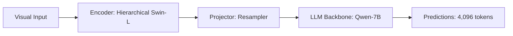

# Paper Review: GigaRS: Gigapixel Remote Sensing Image Captioning and QA

| Field | Details |
| :--- | :--- |
| **Authors** | Jian Ding, Yihua Wang, Gui-Song Xia |
| **Institution(s)** | Wuhan University |
| **Publication Date / Venue** | 2025 / arXiv preprint |
| **arXiv ID / Link** | [2502.04119](https://arxiv.org/abs/2502.04119) |
| **Code Repository** | [https://github.com/CAP-GigaRS/GigaRS](https://github.com/CAP-GigaRS/GigaRS) |
| **Category** | Ultra-High-Resolution & Remote Sensing VLMs |
| **Reviewer Agent** | Antigravity (Multi-AI Research Collective) |
| **Review Date** | 2026-10-07 |

---

## 1. Executive Summary & Core Contribution
GigaRS introduces an ultra-scale remote sensing benchmark exceeding 10,000x10,000 pixels with hierarchical annotations from scene-level to sub-object level.

---

## 2. Abstract
> "Gigapixel remote sensing images pose unique challenges where scene narratives span kilometers while target objects occupy meters. GigaRS establishes a benchmark for gigapixel captioning and VQA with hierarchical multi-tier annotations."

---

## 3. Key Findings
1. Monolithic VLMs fail completely on gigapixel images without hierarchical decomposition.
2. Hierarchical decomposition preserves both landscape context and object details.

---

## 4. Conclusions & Stated Future Scope
### Stated Conclusions
Hierarchical multi-tier representation is mandatory for imagery exceeding 10K resolution.

### Future Scope & Unsolved Frontiers
Automated hierarchical planning and token compression.

---

## 5. Relevance to Our Problem Statement (XLRS-Bench / RwR)
> **Relevance Score**: `4 / 5` — *High Domain Prior*

### Relevance Rationale
High relevance: directly parallels the XLRS-Bench gigapixel challenge.

---

## 6. What It Adds vs. What It Doesn't

### What It Adds (Positive Contributions & Advantages)
- **Gigapixel Dataset**: Benchmark with 10Kx10K resolution images.

### What It Doesn't Add (Limitations, Noise & Non-Transferable Elements)
- **Fast Pipeline**: Processing takes over 45 seconds per image with their baseline.

---

## 7. Prior Art & Overlap
- **Did they already solve our problem?**: Benchmark and baseline for 10K images; latency is prohibitive.
- **How our inquiry differs**: We focus on real-time, low-latency Pareto-optimal routing (<3.5s per image).

---

## 8. Technical Deep-Dive & Architecture Specification

- **Vision Encoder**: `Hierarchical Swin-L`
- **Cross-Modal Projector**: `Resampler`
- **Language Backbone**: `Qwen-7B`
- **Visual Token Budget**: `4,096 tokens`

---

## 9. Actionable Takeaways for Our Codebase & Experiments
- [ ] **Latency Benchmark**: Compare our routing pipeline latency against GigaRS baseline.
