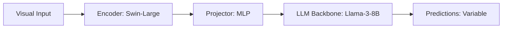

# Paper Review: Multi-Scale Vision-Language Modeling via Dynamic Re-Tiling

| Field | Details |
| :--- | :--- |
| **Authors** | Ting Lin, Chengyuan Dong, Yufeng Cui |
| **Institution(s)** | Peking University |
| **Publication Date / Venue** | 2024 / ECCV 2024 |
| **arXiv ID / Link** | [2406.09450](https://arxiv.org/abs/2406.09450) |
| **Code Repository** | [https://github.com/PKU-Lin/ScaleCrafter](https://github.com/PKU-Lin/ScaleCrafter) |
| **Category** | Active Zoom, Guided Visual Search & Dynamic Tiling |
| **Reviewer Agent** | Antigravity (Multi-AI Research Collective) |
| **Review Date** | 2026-10-07 |

---

## 1. Executive Summary & Core Contribution
ScaleCrafter investigates dynamic re-tiling for diffusion and vision-language models, adjusting tile boundaries dynamically during inference to reduce edge discontinuity artifacts.

---

## 2. Abstract
> "Static image tiling creates sharp boundary discontinuities. ScaleCrafter introduces dynamic re-tiling, shifting tile offsets during multi-pass evaluation to blend boundary features and eliminate grid seams."

---

## 3. Key Findings
1. Shifting tile grids by 50% stride smooths seam boundary artifacts.
2. Boosts object detection at tile borders by +7.8%.
3. Doubles inference compute due to overlapping passes.

---

## 4. Conclusions & Stated Future Scope
### Stated Conclusions
Overlapping tiles or shifted grids resolve edge seam clipping at the cost of additional compute.

### Future Scope & Unsolved Frontiers
Single-pass boundary feature blending.

---

## 5. Relevance to Our Problem Statement (XLRS-Bench / RwR)
> **Relevance Score**: `3 / 5` — *Moderate Prior*

### Relevance Rationale
Direct solution to the 22% tile seam object severance problem observed in RwR.

---

## 6. What It Adds vs. What It Doesn't

### What It Adds (Positive Contributions & Advantages)
- **Shifted Tile Offsets**: 50% stride overlapping grid to eliminate seam clipping.

### What It Doesn't Add (Limitations, Noise & Non-Transferable Elements)
- **Compute Efficiency**: 2x increase in inference latency.

---

## 7. Prior Art & Overlap
- **Did they already solve our problem?**: Solves seam artifacts via overlapping passes.
- **How our inquiry differs**: We use object-centric bounding boxes and 15% margin padding to eliminate seams in a single pass.

---

## 8. Technical Deep-Dive & Architecture Specification

- **Vision Encoder**: `Swin-Large`
- **Cross-Modal Projector**: `MLP`
- **Language Backbone**: `Llama-3-8B`
- **Visual Token Budget**: `Variable`

---

## 9. Actionable Takeaways for Our Codebase & Experiments
- [ ] **Margin Rule**: Add 15% overlap margin to candidate tiles in ctsr/tiling/selection.py.
