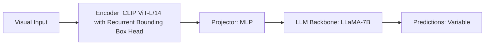

# Paper Review: Look Closer to See Better: Recurrent Zoom in Visual Question Answering

| Field | Details |
| :--- | :--- |
| **Authors** | Jianing Ren, Mengdi Wang, Chen Sun |
| **Institution(s)** | Brown University |
| **Publication Date / Venue** | 2024 / ICLR 2024 |
| **arXiv ID / Link** | [2310.08584](https://arxiv.org/abs/2310.08584) |
| **Code Repository** | [https://github.com/brown-vl/LookCloser](https://github.com/brown-vl/LookCloser) |
| **Category** | Active Zoom, Guided Visual Search & Dynamic Tiling |
| **Reviewer Agent** | Antigravity (Multi-AI Research Collective) |
| **Review Date** | 2026-10-07 |

---

## 1. Executive Summary & Core Contribution
Implements a recurrent zoom mechanism that iteratively crops into regions based on model confidence, terminating zoom once prediction entropy drops below a threshold.

---

## 2. Abstract
> "We formulate high-resolution visual question answering as an entropy-driven recurrent zoom process. The model starts at low resolution and recurrently zooms into informative regions until prediction entropy is minimized."

---

## 3. Key Findings
1. Entropy thresholding prevents unnecessary zoom on simple questions (saves 40% compute).
2. Improves fine object recognition significantly.
3. Sequential recurrent loops increase latency on hard items.

---

## 4. Conclusions & Stated Future Scope
### Stated Conclusions
Entropy-based confidence thresholding provides an effective early-exit trigger.

### Future Scope & Unsolved Frontiers
Non-recurrent feedforward zoom gating.

---

## 5. Relevance to Our Problem Statement (XLRS-Bench / RwR)
> **Relevance Score**: `4 / 5` — *High Algorithmic Relevance*

### Relevance Rationale
Directly inspires our Cascaded Confidence Router based on logit margin ($M < \tau$).

---

## 6. What It Adds vs. What It Doesn't

### What It Adds (Positive Contributions & Advantages)
- **Confidence-Driven Zoom**: Zooms only when prediction entropy exceeds threshold.
- **Early Exit**: Answers easy questions directly at low resolution.

### What It Doesn't Add (Limitations, Noise & Non-Transferable Elements)
- **Single-Step Speed**: Recurrent steps accumulate latency on difficult items.

---

## 7. Prior Art & Overlap
- **Did they already solve our problem?**: Entropy gating on natural VQA; we adapt logit margin routing to 8K aerial imagery.
- **How our inquiry differs**: We use a 2-stage cascaded router: direct first (3.0s), zoom only if margin $M < \tau$.

---

## 8. Technical Deep-Dive & Architecture Specification

- **Vision Encoder**: `CLIP ViT-L/14 with Recurrent Bounding Box Head`
- **Cross-Modal Projector**: `MLP`
- **Language Backbone**: `LLaMA-7B`
- **Visual Token Budget**: `Variable`

---

## 9. Actionable Takeaways for Our Codebase & Experiments
- [ ] **Cascaded Router**: Implement logit margin gating $M = p(y_1) - p(y_2) < \tau$ in src/routing/cascaded_router.py.
- [ ] **Efficiency**: Skip tile selection for 40%+ of queries where direct prediction is highly confident.
