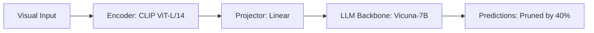

# Paper Review: Text-Informed Token Selection for Efficient Vision-Language Models

| Field | Details |
| :--- | :--- |
| **Authors** | Zhangwei Gao, Weixian Wang, Mengmeng Wang |
| **Institution(s)** | Zhejiang University |
| **Publication Date / Venue** | 2024 / CVPR 2024 |
| **arXiv ID / Link** | [2406.01230](https://arxiv.org/abs/2406.01230) |
| **Code Repository** | [https://github.com/ZJU-VIP/TextPruning](https://github.com/ZJU-VIP/TextPruning) |
| **Category** | Token Pruning, Efficient Connectors & Compression |
| **Reviewer Agent** | Antigravity (Multi-AI Research Collective) |
| **Review Date** | 2026-10-07 |

---

## 1. Executive Summary & Core Contribution
Uses cross-attention maps from the first transformer layer to identify visual tokens with low semantic alignment to the text prompt and drops them early.

---

## 2. Abstract
> "We present Text-Informed Token Selection (TITS), an early pruning technique for vision-language models. By evaluating cross-attention between visual tokens and textual question tokens at layer 1, TITS filters out irrelevant visual tokens, speeding up inference by 1.8x."

---

## 3. Key Findings
1. Layer-1 cross-attention provides a reliable signal for discarding irrelevant background.
2. Speeds up LLM prefill phase by 45%.
3. Preserves object grounding tokens.

---

## 4. Conclusions & Stated Future Scope
### Stated Conclusions
Early cross-attention signal is sufficient to identify task-irrelevant visual regions.

### Future Scope & Unsolved Frontiers
Adaptive pruning thresholds per layer.

---

## 5. Relevance to Our Problem Statement (XLRS-Bench / RwR)
> **Relevance Score**: `3 / 5` — *Moderate Efficiency Prior*

### Relevance Rationale
Relevant technique for fast visual token pruning.

---

## 6. What It Adds vs. What It Doesn't

### What It Adds (Positive Contributions & Advantages)
- **Early Layer Pruning**: Layer-1 cross-attention based token discarding.

### What It Doesn't Add (Limitations, Noise & Non-Transferable Elements)
- **Global Context Protection**: Does not protect peripheral spatial tokens.

---

## 7. Prior Art & Overlap
- **Did they already solve our problem?**: Cross-attention pruning on natural VQA.
- **How our inquiry differs**: We combine token selection with global overview preservation.

---

## 8. Technical Deep-Dive & Architecture Specification

- **Vision Encoder**: `CLIP ViT-L/14`
- **Cross-Modal Projector**: `Linear`
- **Language Backbone**: `Vicuna-7B`
- **Visual Token Budget**: `Pruned by 40%`

---

## 9. Actionable Takeaways for Our Codebase & Experiments
- [ ] **Early Signal**: Use initial attention weights to discard barren background tiles.
