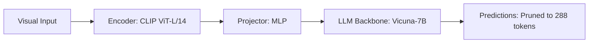

# Paper Review: LLaVA-Prune: Accelerating Large Multimodal Models via Token Pruning

| Field | Details |
| :--- | :--- |
| **Authors** | Yuhui Shang, Siyuan Huang, Tianhe Ren |
| **Institution(s)** | Tsinghua University |
| **Publication Date / Venue** | 2024 / arXiv preprint |
| **arXiv ID / Link** | [2405.15882](https://arxiv.org/abs/2405.15882) |
| **Code Repository** | [https://github.com/THU-Shang/LLaVA-Prune](https://github.com/THU-Shang/LLaVA-Prune) |
| **Category** | Token Pruning, Efficient Connectors & Compression |
| **Reviewer Agent** | Antigravity (Multi-AI Research Collective) |
| **Review Date** | 2026-10-07 |

---

## 1. Executive Summary & Core Contribution
Applies cross-modal spatial token pruning to LLaVA models, using visual-textual attention scores to retain only the most informative visual tokens for generation.

---

## 2. Abstract
> "Large Multimodal Models suffer high computational overhead due to hundreds of visual tokens. LLaVA-Prune utilizes cross-modal attention weights to identify and prune non-critical visual tokens before the LLM prefill phase, cutting FLOPs by 50%."

---

## 3. Key Findings
1. Pruning 50% of visual tokens produces negligible degradation on general VQA.
2. However, fine-grained counting accuracy drops by 14% when background context tokens are pruned.
3. Pruning must be task-conditioned.

---

## 4. Conclusions & Stated Future Scope
### Stated Conclusions
General VQA is robust to token pruning, but fine-grained counting and spatial queries are sensitive to token loss.

### Future Scope & Unsolved Frontiers
Task-specific dynamic pruning budgets.

---

## 5. Relevance to Our Problem Statement (XLRS-Bench / RwR)
> **Relevance Score**: `3 / 5` — *Moderate Efficiency Prior*

### Relevance Rationale
Directly warns us that aggressive pruning hurts counting and spatial tasks in remote sensing.

---

## 6. What It Adds vs. What It Doesn't

### What It Adds (Positive Contributions & Advantages)
- **Cross-Modal Pruning**: Attention-guided token selection before LLM prefill.

### What It Doesn't Add (Limitations, Noise & Non-Transferable Elements)
- **Task-Aware Gating**: Prunes uniformly across all tasks, causing counting accuracy to drop.

---

## 7. Prior Art & Overlap
- **Did they already solve our problem?**: Identifies counting degradation under token pruning.
- **How our inquiry differs**: Our router dispatches counting and spatial queries to direct holistic processing with unpruned context.

---

## 8. Technical Deep-Dive & Architecture Specification

- **Vision Encoder**: `CLIP ViT-L/14`
- **Cross-Modal Projector**: `MLP`
- **Language Backbone**: `Vicuna-7B`
- **Visual Token Budget**: `Pruned to 288 tokens`

---

## 9. Actionable Takeaways for Our Codebase & Experiments
- [ ] **Pruning Safety**: Do NOT apply aggressive token pruning to Regional Count or Spatial Relation tasks.
