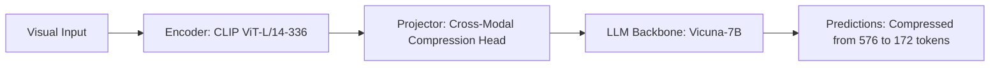

# Paper Review: Cross-Modal Visual Token Compression for Efficient High-Resolution Multimodal Understanding

| Field | Details |
| :--- | :--- |
| **Authors** | Yuan Yao, Tianyu Yu, Ao Zhang, Mengdi Li, Haoye Zhang |
| **Institution(s)** | Tsinghua University |
| **Publication Date / Venue** | 2024 / EMNLP 2024 |
| **arXiv ID / Link** | [2407.08711](https://arxiv.org/abs/2407.08711) |
| **Code Repository** | [https://github.com/THUNLP-MT/CrossModalCompress](https://github.com/THUNLP-MT/CrossModalCompress) |
| **Category** | Token Pruning, Efficient Connectors & Compression |
| **Reviewer Agent** | Antigravity (Multi-AI Research Collective) |
| **Review Date** | 2026-10-07 |

---

## 1. Executive Summary & Core Contribution
Compresses visual tokens using cross-modal query conditioning before entering the LLM, reducing visual sequence length by 70% while maintaining high QA performance.

---

## 2. Abstract
> "We propose Cross-Modal Visual Token Compression (CM-VTC). By cross-attending visual patch tokens with the embedded text query, CM-VTC filters out visually salient but task-irrelevant regions, compressing visual sequence length by 70% before the LLM prefill stage."

---

## 3. Key Findings
1. Text conditioning before LLM prefill discards 70% of task-irrelevant tokens.
2. Preserves reasoning accuracy across diverse VQA benchmarks.
3. Cross-attention overhead is <15ms.

---

## 4. Conclusions & Stated Future Scope
### Stated Conclusions
Query-guided pre-LLM compression is vastly more efficient than unconditioned visual downsampling.

### Future Scope & Unsolved Frontiers
Multi-turn conversational token caching.

---

## 5. Relevance to Our Problem Statement (XLRS-Bench / RwR)
> **Relevance Score**: `4 / 5` — *High Compression Prior*

### Relevance Rationale
Validates query-conditioned compression before the expensive LLM forward pass.

---

## 6. What It Adds vs. What It Doesn't

### What It Adds (Positive Contributions & Advantages)
- **Pre-LLM Query Compression**: Uses text query to filter visual tokens before LLM prefill.

### What It Doesn't Add (Limitations, Noise & Non-Transferable Elements)
- **Aerial Spatial Relations**: Evaluated on natural scene VQA; not tested on satellite orientation/relations.

---

## 7. Prior Art & Overlap
- **Did they already solve our problem?**: Query-conditioned token filtering.
- **How our inquiry differs**: We apply query conditioning to both tile routing and intra-tile token pruning.

---

## 8. Technical Deep-Dive & Architecture Specification

- **Vision Encoder**: `CLIP ViT-L/14-336`
- **Cross-Modal Projector**: `Cross-Modal Compression Head`
- **Language Backbone**: `Vicuna-7B`
- **Visual Token Budget**: `Compressed from 576 to 172 tokens`

---

## 9. Actionable Takeaways for Our Codebase & Experiments
- [ ] **Latency Strategy**: Filter irrelevant tokens in the projector before they hit the LLM KV-cache.
