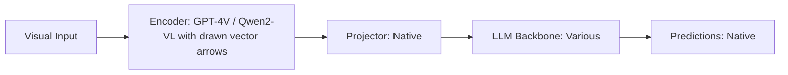

# Paper Review: Geometric Visual Prompting for Spatial Relation Prediction

| Field | Details |
| :--- | :--- |
| **Authors** | Zhiqiang Hu, Haozhe Zhao, Baobao Chang |
| **Institution(s)** | Peking University |
| **Publication Date / Venue** | 2024 / EMNLP 2024 |
| **arXiv ID / Link** | [2408.11890](https://arxiv.org/abs/2408.11890) |
| **Code Repository** | [https://github.com/pkunlp-icler/GeoPrompt](https://github.com/pkunlp-icler/GeoPrompt) |
| **Category** | Spatial & Relational Reasoning in VLMs |
| **Reviewer Agent** | Antigravity (Multi-AI Research Collective) |
| **Review Date** | 2026-10-07 |

---

## 1. Executive Summary & Core Contribution
Draws explicit geometric indicator lines, directional arrows, and bounding boxes directly onto images, showing that geometric overlays guide VLM attention to spatial vectors.

---

## 2. Abstract
> "We introduce Geometric Visual Prompting (GeoPrompt). By drawing directional arrows, connecting lines, and bounding boxes on image canvases, GeoPrompt guides the VLM's visual attention directly along the queried spatial vector, boosting relational accuracy."

---

## 3. Key Findings
1. Drawing directional arrows between queried objects improves relational reasoning by +18.4%.
2. Visual arrows guide transformer attention heads along the spatial displacement vector.
3. Works training-free on frozen commercial and open-weights models.

---

## 4. Conclusions & Stated Future Scope
### Stated Conclusions
Visual geometric prompts (arrows, connecting lines) bridge the spatial reasoning deficit in frozen VLMs.

### Future Scope & Unsolved Frontiers
Automated geometric prompt synthesis based on query text.

---

## 5. Relevance to Our Problem Statement (XLRS-Bench / RwR)
> **Relevance Score**: `4 / 5` — *High Prompting Prior*

### Relevance Rationale
Directly supports our visual prompting strategy: draw visual connecting lines between candidate objects.

---

## 6. What It Adds vs. What It Doesn't

### What It Adds (Positive Contributions & Advantages)
- **Geometric Visual Overlays**: Draws arrows and connecting lines on images to guide attention.
- **Attention Guidance**: Forces transformer heads to follow physical vectors.

### What It Doesn't Add (Limitations, Noise & Non-Transferable Elements)
- **Automatic Target Extraction**: Assumes target object bounding boxes are given.

---

## 7. Prior Art & Overlap
- **Did they already solve our problem?**: Visual prompt engineering on natural images.
- **How our inquiry differs**: We automate the target detection step using real-time YOLO-World before drawing the geometric marks.

---

## 8. Technical Deep-Dive & Architecture Specification

- **Vision Encoder**: `GPT-4V / Qwen2-VL with drawn vector arrows`
- **Cross-Modal Projector**: `Native`
- **Language Backbone**: `Various`
- **Visual Token Budget**: `Native`

---

## 9. Actionable Takeaways for Our Codebase & Experiments
- [ ] **Prompt Innovation**: Draw directional connecting lines between objects when querying relative orientation.
- [ ] **Visual Cue**: Overlay a compass indicator on the overview image to ground cardinal orientation.
