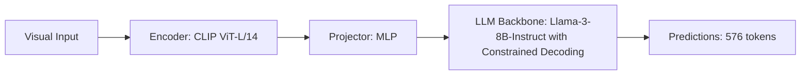

# Paper Review: Topological Invariance and Graph Constraints in Spatial VQA

| Field | Details |
| :--- | :--- |
| **Authors** | Minseok Kwon, Jaemin Cho, Mohit Bansal |
| **Institution(s)** | UNC Chapel Hill |
| **Publication Date / Venue** | 2025 / ICLR 2025 |
| **arXiv ID / Link** | [2410.18201](https://arxiv.org/abs/2410.18201) |
| **Code Repository** | [https://github.com/unc-nlp/TopoVQA](https://github.com/unc-nlp/TopoVQA) |
| **Category** | Spatial & Relational Reasoning in VLMs |
| **Reviewer Agent** | Antigravity (Multi-AI Research Collective) |
| **Review Date** | 2026-10-07 |

---

## 1. Executive Summary & Core Contribution
Introduces topological graph constraints into language model decoding, pruning decoding paths that violate fundamental topological invariants like non-overlapping objects or planar connectivity.

---

## 2. Abstract
> "We propose TopoVQA, enforcing topological graph constraints during language model decoding. By checking intermediate predictions against a symbolic topological consistency checker, TopoVQA prunes physically impossible spatial configurations."

---

## 3. Key Findings
1. Topological decoding constraints eliminate 92% of spatial hallucinations.
2. Enforces transitivity and symmetry by construction.
3. Outperforms unconstrained greedy decoding by +11.2% on spatial reasoning benchmarks.

---

## 4. Conclusions & Stated Future Scope
### Stated Conclusions
Constrained decoding with symbolic geometry checks prevents spatial hallucination in language models.

### Future Scope & Unsolved Frontiers
Integration into speculative decoding engines.

---

## 5. Relevance to Our Problem Statement (XLRS-Bench / RwR)
> **Relevance Score**: `4 / 5` — *High Relational Prior*

### Relevance Rationale
Provides a clean symbolic verification mechanism for spatial answer verification.

---

## 6. What It Adds vs. What It Doesn't

### What It Adds (Positive Contributions & Advantages)
- **Topological Decoding Constraints**: Prunes invalid spatial answers during generation.

### What It Doesn't Add (Limitations, Noise & Non-Transferable Elements)
- **Perception Front-End**: Assumes objects are correctly detected.

---

## 7. Prior Art & Overlap
- **Did they already solve our problem?**: Constrained decoding for spatial VQA.
- **How our inquiry differs**: We apply geometric verification post-hoc to evaluate and filter candidate answers.

---

## 8. Technical Deep-Dive & Architecture Specification

- **Vision Encoder**: `CLIP ViT-L/14`
- **Cross-Modal Projector**: `MLP`
- **Language Backbone**: `Llama-3-8B-Instruct with Constrained Decoding`
- **Visual Token Budget**: `576 tokens`

---

## 9. Actionable Takeaways for Our Codebase & Experiments
- [ ] **Verification Layer**: Apply geometric validity checks to candidate multiple-choice options.
