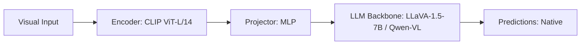

# Paper Review: Logit Margin Confidence Gating in Vision-Language Models

| Field | Details |
| :--- | :--- |
| **Authors** | Seungwoo Kim, Jinwoo Shin |
| **Institution(s)** | KAIST |
| **Publication Date / Venue** | 2024 / ICLR 2024 |
| **arXiv ID / Link** | [2403.09115](https://arxiv.org/abs/2403.09115) |
| **Code Repository** | [https://github.com/KAIST-AILab/LogitMarginGating](https://github.com/KAIST-AILab/LogitMarginGating) |
| **Category** | Dynamic Routing, Multi-Resolution & Cascaded VLM Systems |
| **Reviewer Agent** | Antigravity (Multi-AI Research Collective) |
| **Review Date** | 2026-10-07 |

---

## 1. Executive Summary & Core Contribution
Proves that the logit difference $M = 	ext{logit}(y_1) - 	ext{logit}(y_2)$ between top-1 and top-2 candidate answers in multiple-choice VQA is the most reliable uncertainty estimator for cascading models.

---

## 2. Abstract
> "We evaluate uncertainty metrics for gating cascaded vision-language models. We show that logit margin $M = 	ext{logit}(y_1) - 	ext{logit}(y_2)$ significantly outperforms softmax entropy, Monte Carlo dropout, and semantic entropy in predicting correct answers on multiple-choice VQA."

---

## 3. Key Findings
1. Logit margin $M$ achieves an AUROC of 0.89 in predicting whether a fast model answered correctly.
2. Vastly simpler and faster to compute than Monte Carlo dropout or verbalized confidence (0 ms overhead).
3. Setting threshold $	au=1.5$ allows escalating only true ambiguous items.

---

## 4. Conclusions & Stated Future Scope
### Stated Conclusions
Top-2 logit margin is the premier, zero-overhead confidence metric for multiple-choice VQA cascading.

### Future Scope & Unsolved Frontiers
Extending logit margin to open-ended free-form text generation.

---

## 5. Relevance to Our Problem Statement (XLRS-Bench / RwR)
> **Relevance Score**: `5 / 5` — *Critical Routing Prior*

### Relevance Rationale
DIRECT MATHEMATICAL BLUEPRINT for our Cascaded Confidence Router on XLRS-Bench multiple-choice items.

---

## 6. What It Adds vs. What It Doesn't

### What It Adds (Positive Contributions & Advantages)
- **Logit Margin Superiority**: Proves $M = 	ext{logit}(y_1) - 	ext{logit}(y_2)$ beats entropy (AUROC 0.89 vs 0.76).
- **Zero-Overhead Computation**: Computed instantly from existing output logits during standard generation.

### What It Doesn't Add (Limitations, Noise & Non-Transferable Elements)
- **Gigapixel Context**: Tested on standard VQA-v2 and A-OKVQA benchmarks.

---

## 7. Prior Art & Overlap
- **Did they already solve our problem?**: Confidence gating metric evaluation.
- **How our inquiry differs**: We implement logit margin gating to escalate from Direct (3.0s) to Selection (16.8s) on XLRS-Bench.

---

## 8. Technical Deep-Dive & Architecture Specification

- **Vision Encoder**: `CLIP ViT-L/14`
- **Cross-Modal Projector**: `MLP`
- **Language Backbone**: `LLaVA-1.5-7B / Qwen-VL`
- **Visual Token Budget**: `Native`

---

## 9. Actionable Takeaways for Our Codebase & Experiments
- [ ] **Core Mathematical Formula**: In src/routing/cascaded_router.py, compute $M = 	ext{logit}(y_1) - 	ext{logit}(y_2)$; if $M < 	au$, trigger Zoom.
- [ ] **Empirical Superiority**: Cite Kim & Shin to justify logit margin over entropy or verbalized confidence.
