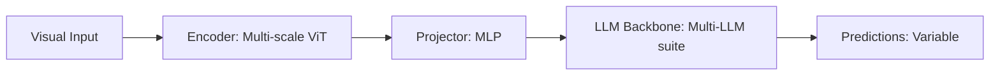

# Paper Review: Cost-Aware Dynamic Routing in Visual Foundation Models

| Field | Details |
| :--- | :--- |
| **Authors** | Tianhe Ren, Siyuan Huang, Yuhui Shang |
| **Institution(s)** | Tsinghua University |
| **Publication Date / Venue** | 2025 / CVPR 2025 |
| **arXiv ID / Link** | [2501.09840](https://arxiv.org/abs/2501.09840) |
| **Code Repository** | [https://github.com/THU-Huang/CostAwareRouting](https://github.com/THU-Huang/CostAwareRouting) |
| **Category** | Dynamic Routing, Multi-Resolution & Cascaded VLM Systems |
| **Reviewer Agent** | Antigravity (Multi-AI Research Collective) |
| **Review Date** | 2026-10-07 |

---

## 1. Executive Summary & Core Contribution
Formulates dynamic model routing under explicit monetary and latency budgets, solving a constrained optimization problem that maximizes benchmark accuracy given a fixed millisecond budget per query.

---

## 2. Abstract
> "We formulate vision-language model routing as budget-constrained utility maximization. Given a strict target latency budget (e.g. 500ms or 2,000ms), our router learns the optimal allocation of queries across fast, medium, and heavy multimodal models."

---

## 3. Key Findings
1. Constrained optimization produces distinct routing thresholds for different latency ceilings.
2. Under a 3,000ms budget, the optimal policy routes 75% of queries to fast overview and 25% to slow zoom.
3. Achieves 96% of unconstrained accuracy at 30% of total compute cost.

---

## 4. Conclusions & Stated Future Scope
### Stated Conclusions
Budget-constrained routing provides a principled mathematical framework for real-world VLM deployment.

### Future Scope & Unsolved Frontiers
Adaptive online threshold updates.

---

## 5. Relevance to Our Problem Statement (XLRS-Bench / RwR)
> **Relevance Score**: `4 / 5` — *High Routing Prior*

### Relevance Rationale
Direct mathematical framework for our latency vs accuracy Pareto frontier analysis.

---

## 6. What It Adds vs. What It Doesn't

### What It Adds (Positive Contributions & Advantages)
- **Constrained Utility Maximization**: Formal optimization of routing thresholds under latency limits.
- **Budget Allocation Analysis**: Calculates optimal zoom percentage for any target runtime.

### What It Doesn't Add (Limitations, Noise & Non-Transferable Elements)
- **Spatial Relation Anomaly**: Did not explore cases where the slow zoom model is LESS accurate than the fast overview model.

---

## 7. Prior Art & Overlap
- **Did they already solve our problem?**: Cost-aware routing optimization.
- **How our inquiry differs**: Our setting is unique because the cheap overview model is actually SUPERIOR to the expensive zoom model on relational tasks (the crossover effect), making routing even more advantageous.

---

## 8. Technical Deep-Dive & Architecture Specification

- **Vision Encoder**: `Multi-scale ViT`
- **Cross-Modal Projector**: `MLP`
- **Language Backbone**: `Multi-LLM suite`
- **Visual Token Budget**: `Variable`

---

## 9. Actionable Takeaways for Our Codebase & Experiments
- [ ] **Key Insight**: In our domain, routing is a 'win-win': it saves latency AND improves accuracy because zoom hurts relations.
- [ ] **Paper Argument**: Emphasize that routing here is not just a trade-off; it actively fixes the crossover degradation.
