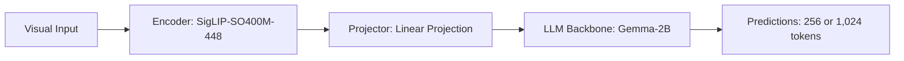

# Paper Review: PaliGemma: A Versatile 3B VLM for Transfer

| Field | Details |
| :--- | :--- |
| **Authors** | Lucas Beyer, Andreas Steiner, Andre Susano Pinto, Alexander Kolesnikov, Xiao Wang, Daniel Salz, Maxim Neumann, Ibrahim Alabdulmohsin, Michael Tschannen, Emanuele Bugliarello, Thomas Kipf, Juraj Gotkowski, Ali Elqursh, Mostafa Dehghani, et al. |
| **Institution(s)** | Google DeepMind |
| **Publication Date / Venue** | 2024 / arXiv preprint |
| **arXiv ID / Link** | [2407.07726](https://arxiv.org/abs/2407.07726) |
| **Code Repository** | [https://github.com/google-research/big_vision](https://github.com/google-research/big_vision) |
| **Category** | General Foundation VLMs & Multi-Crop Connectors |
| **Reviewer Agent** | Antigravity (Multi-AI Research Collective) |
| **Review Date** | 2026-10-07 |

---

## 1. Executive Summary & Core Contribution
Introduces PaliGemma, pairing SigLIP-SO400M with Gemma-2B via a linear projection layer, optimized for fast fine-tuning on downstream vision-language tasks including grounding and detection.

---

## 2. Abstract
> "We present PaliGemma, a versatile 3B vision-language model trained for fine-tuning transfer. PaliGemma connects a SigLIP-SO400M vision encoder to a Gemma-2B language model, achieving state-of-the-art transfer results across diverse vision benchmarks."

---

## 3. Key Findings
1. Compact 3B parameter size runs in <100ms per image on modern GPUs.
2. Strong visual grounding performance when fine-tuned with coordinate tokens.
3. Native resolution support up to 896x896.

---

## 4. Conclusions & Stated Future Scope
### Stated Conclusions
Lightweight 3B models achieve competitive grounding performance when initialized with strong vision encoders (SigLIP).

### Future Scope & Unsolved Frontiers
PaliGemma-2 scaling.

---

## 5. Relevance to Our Problem Statement (XLRS-Bench / RwR)
> **Relevance Score**: `4 / 5` — *High Lightweight Baseline*

### Relevance Rationale
Excellent lightweight candidate for our fast router or local crop verification module.

---

## 6. What It Adds vs. What It Doesn't

### What It Adds (Positive Contributions & Advantages)
- **Lightweight 3B Architecture**: SigLIP-SO400M + Gemma-2B.
- **Fast Fine-Tuning Recipe**: Standardized transfer learning benchmark.

### What It Doesn't Add (Limitations, Noise & Non-Transferable Elements)
- **Multi-Crop Tile Slicing**: Single image input; requires external tiling for 8K images.

---

## 7. Prior Art & Overlap
- **Did they already solve our problem?**: Lightweight open-weights VLM.
- **How our inquiry differs**: We use PaliGemma as a fast candidate verification model in our cascaded router.

---

## 8. Technical Deep-Dive & Architecture Specification

- **Vision Encoder**: `SigLIP-SO400M-448`
- **Cross-Modal Projector**: `Linear Projection`
- **Language Backbone**: `Gemma-2B`
- **Visual Token Budget**: `256 or 1,024 tokens`

---

## 9. Actionable Takeaways for Our Codebase & Experiments
- [ ] **Lightweight Candidate**: PaliGemma-3B is an ideal low-cost draft model for speculative cascading.
