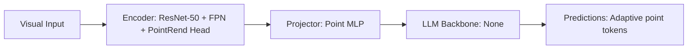

# Paper Review: PointRend: Image Segmentation as Rendering

| Field | Details |
| :--- | :--- |
| **Authors** | Alexander Kirillov, Yuxin Wu, Kaiming He, Ross Girshick |
| **Institution(s)** | Facebook AI Research |
| **Publication Date / Venue** | 2020 / CVPR 2020 |
| **arXiv ID / Link** | [1912.08193](https://arxiv.org/abs/1912.08193) |
| **Code Repository** | [https://github.com/facebookresearch/detectron2](https://github.com/facebookresearch/detectron2) |
| **Category** | General Foundation VLMs & Multi-Crop Connectors |
| **Reviewer Agent** | Antigravity (Multi-AI Research Collective) |
| **Review Date** | 2026-10-07 |

---

## 1. Executive Summary & Core Contribution
Treats image segmentation as a computer graphics rendering problem, adaptively sampling points along ambiguous boundaries to compute high-resolution edges without uniform dense compute.

---

## 2. Abstract
> "We present PointRend, viewing image segmentation as a rendering problem. PointRend performs adaptive subdivision, sampling only a non-uniform set of points along uncertain object boundaries, computing crisp high-resolution edge masks at a fraction of the memory."

---

## 3. Key Findings
1. Non-uniform point sampling computes high-resolution boundaries without uniform grid explosion.
2. Allocates compute strictly where boundary uncertainty is highest.
3. Inspires adaptive visual token sampling along object borders.

---

## 4. Conclusions & Stated Future Scope
### Stated Conclusions
Adaptive point subdivision renders fine details efficiently by concentrating compute on uncertain boundary regions.

### Future Scope & Unsolved Frontiers
Adaptive point sampling in vision transformers.

---

## 5. Relevance to Our Problem Statement (XLRS-Bench / RwR)
> **Relevance Score**: `4 / 5` — *Foundational Adaptive Sampling*

### Relevance Rationale
Core conceptual blueprint for why compute should be allocated adaptively to boundaries rather than uniform grids.

---

## 6. What It Adds vs. What It Doesn't

### What It Adds (Positive Contributions & Advantages)
- **Adaptive Boundary Subdivision**: Samples points non-uniformly along high-entropy object edges.

### What It Doesn't Add (Limitations, Noise & Non-Transferable Elements)
- **Multimodal Language Models**: Segmentation head for Mask R-CNN.

---

## 7. Prior Art & Overlap
- **Did they already solve our problem?**: Adaptive point sampling in computer vision.
- **How our inquiry differs**: We apply the adaptive sampling philosophy to gigapixel crop selection in VLMs.

---

## 8. Technical Deep-Dive & Architecture Specification

- **Vision Encoder**: `ResNet-50 + FPN + PointRend Head`
- **Cross-Modal Projector**: `Point MLP`
- **Language Backbone**: `None`
- **Visual Token Budget**: `Adaptive point tokens`

---

## 9. Actionable Takeaways for Our Codebase & Experiments
- [ ] **Algorithmic Philosophy**: Concentrate high-resolution tokens on object boundaries; leave uniform background at low resolution.
