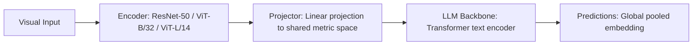

# Paper Review: Learning Transferable Visual Models From Natural Language Supervision

| Field | Details |
| :--- | :--- |
| **Authors** | Alec Radford, Jong Wook Kim, Chris Hallacy, Aditya Ramesh, Gabriel Goh, Sandhini Agarwal, Girish Sastry, Amanda Askell, Pamela Mishkin, Jack Clark, Gretchen Krueger, Ilya Sutskever |
| **Institution(s)** | OpenAI |
| **Publication Date / Venue** | 2021 / ICML 2021 |
| **arXiv ID / Link** | [2103.00020](https://arxiv.org/abs/2103.00020) |
| **Code Repository** | [https://github.com/openai/CLIP](https://github.com/openai/CLIP) |
| **Category** | General Foundation VLMs & Multi-Crop Connectors |
| **Reviewer Agent** | Antigravity (Multi-AI Research Collective) |
| **Review Date** | 2026-10-07 |

---

## 1. Executive Summary & Core Contribution
Pioneered contrastive language-image pre-training (CLIP) on 400M web image-text pairs, establishing the foundational dual-encoder representation used in virtually all modern multimodal models.

---

## 2. Abstract
> "We demonstrate that simple pretraining predicting which caption goes with which image achieves competitive zero-shot transfer across 30+ computer vision benchmarks without task-specific training."

---

## 3. Key Findings
1. Contrastive language-image pretraining aligns visual features with open-vocabulary text concepts.
2. Enables zero-shot image classification and cross-modal retrieval.
3. Inherent limitation: optimizes for semantic categorization, collapsing fine spatial coordinates.

---

## 4. Conclusions & Stated Future Scope
### Stated Conclusions
Language supervision produces highly transferable visual concepts, but contrastive loss discards low-level spatial geometry.

### Future Scope & Unsolved Frontiers
Dense and localized contrastive learning.

---

## 5. Relevance to Our Problem Statement (XLRS-Bench / RwR)
> **Relevance Score**: `4 / 5` — *Foundational Vision-Language Origin*

### Relevance Rationale
Foundational technology used in the RwR tile selector ($s_{clip}$) and baseline models.

---

## 6. What It Adds vs. What It Doesn't

### What It Adds (Positive Contributions & Advantages)
- **Contrastive Vision-Language Pretraining**: Aligns image and text embeddings into a shared metric space.

### What It Doesn't Add (Limitations, Noise & Non-Transferable Elements)
- **Fine Spatial Localization**: Global pooled embedding collapses spatial geometry.

---

## 7. Prior Art & Overlap
- **Did they already solve our problem?**: Foundational paper.
- **How our inquiry differs**: We analyze why CLIP's semantic alignment is insufficient for spatial reasoning on 8K imagery.

---

## 8. Technical Deep-Dive & Architecture Specification

- **Vision Encoder**: `ResNet-50 / ViT-B/32 / ViT-L/14`
- **Cross-Modal Projector**: `Linear projection to shared metric space`
- **Language Backbone**: `Transformer text encoder`
- **Visual Token Budget**: `Global pooled embedding`

---

## 9. Actionable Takeaways for Our Codebase & Experiments
- [ ] **Historic Reference**: Cite CLIP as the origin of the $s_{clip}$ tile scoring mechanism in RwR.
