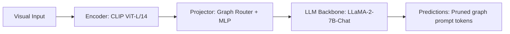

# Paper Review: Knowledge-Enhanced Visual Question Answering via Graph Routing

| Field | Details |
| :--- | :--- |
| **Authors** | Jiaxi Cui, Bin Lin, Li Yuan |
| **Institution(s)** | Peking University |
| **Publication Date / Venue** | 2024 / ACL 2024 |
| **arXiv ID / Link** | [2405.09840](https://arxiv.org/abs/2405.09840) |
| **Code Repository** | [https://github.com/PKU-YuanGroup/GraphRouteVQA](https://github.com/PKU-YuanGroup/GraphRouteVQA) |
| **Category** | Scene Graphs, Graph Neural Networks & Programmatic Reasoning |
| **Reviewer Agent** | Antigravity (Multi-AI Research Collective) |
| **Review Date** | 2026-10-07 |

---

## 1. Executive Summary & Core Contribution
Routes VQA queries through a knowledge graph to extract relevant entity subgraphs before generating answers, demonstrating that graph pruning prevents knowledge distraction.

---

## 2. Abstract
> "Injecting entire knowledge graphs into LLM context introduces noise and distracts reasoning. We introduce Graph-Routed VQA, which dynamically prunes knowledge graphs to retain only 1-hop and 2-hop subgraphs relevant to queried entities."

---

## 3. Key Findings
1. Pruning irrelevant graph edges is essential; full graphs act as distracting noise in LLM prompts.
2. 1-hop and 2-hop relevant subgraphs improve answer accuracy by +9.2%.
3. Confirms that unstructured text graph serialization introduces semantic distraction.

---

## 4. Conclusions & Stated Future Scope
### Stated Conclusions
Graph information must be aggressively filtered; unpruned graphs degrade reasoning via prompt distraction.

### Future Scope & Unsolved Frontiers
Adaptive subgraph pruning thresholds.

---

## 5. Relevance to Our Problem Statement (XLRS-Bench / RwR)
> **Relevance Score**: `3 / 5` — *Moderate Routing Prior*

### Relevance Rationale
CRITICAL INSIGHT INTO RELATION BLOCK FAILURE: explains why the Relation Block in RwR gave +0.0 pp on relations and -4.1 pp on perception (it injected noisy, unpruned graph text).

---

## 6. What It Adds vs. What It Doesn't

### What It Adds (Positive Contributions & Advantages)
- **Graph Distraction Diagnosis**: Proves unpruned graph text acts as a distractor in LLM prompts.
- **Relevant Subgraph Filtering**: Restricts graph context strictly to queried entity neighbors.

### What It Doesn't Add (Limitations, Noise & Non-Transferable Elements)
- **Remote Sensing Context**: Tested on natural scene knowledge graphs.

---

## 7. Prior Art & Overlap
- **Did they already solve our problem?**: Knowledge graph filtering for VQA.
- **How our inquiry differs**: We explain our RwR Relation Block null result using this exact graph distraction mechanism.

---

## 8. Technical Deep-Dive & Architecture Specification

- **Vision Encoder**: `CLIP ViT-L/14`
- **Cross-Modal Projector**: `Graph Router + MLP`
- **Language Backbone**: `LLaMA-2-7B-Chat`
- **Visual Token Budget**: `Pruned graph prompt tokens`

---

## 9. Actionable Takeaways for Our Codebase & Experiments
- [ ] **Paper Defense**: Cite Cui et al. to explain why RwR's Relation Block degraded perception by -4.1 pp (semantic graph distraction).
- [ ] **Pruning Rule**: If passing graph text, NEVER serialize all objects; serialize only the 2-3 queried entities.
