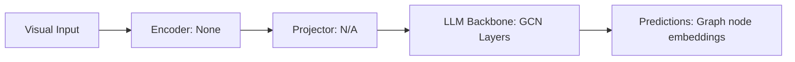

# Paper Review: Semi-Supervised Classification with Graph Convolutional Networks

| Field | Details |
| :--- | :--- |
| **Authors** | Thomas N. Kipf, Max Welling |
| **Institution(s)** | University of Amsterdam |
| **Publication Date / Venue** | 2017 / ICLR 2017 |
| **arXiv ID / Link** | [1609.02907](https://arxiv.org/abs/1609.02907) |
| **Code Repository** | [https://github.com/tkipf/gcn](https://github.com/tkipf/gcn) |
| **Category** | Scene Graphs, Graph Neural Networks & Programmatic Reasoning |
| **Reviewer Agent** | Antigravity (Multi-AI Research Collective) |
| **Review Date** | 2026-10-07 |

---

## 1. Executive Summary & Core Contribution
Pioneered Graph Convolutional Networks (GCN) via localized first-order spectral approximations, creating the foundational neural message passing architecture for graph-structured data.

---

## 2. Abstract
> "We present a scalable approach for semi-supervised learning on graph-structured data based on an efficient localized first-order approximation of spectral graph convolutions. Our GCN model scales linearly in graph edges and learns localized structural representations."

---

## 3. Key Findings
1. Localized graph convolution scales linearly in the number of edges $\mathcal{O}(|E|)$.
2. First-order spectral approximation aggregates 1-hop neighbor features efficiently.
3. Foundational architecture of modern Graph Neural Networks.

---

## 4. Conclusions & Stated Future Scope
### Stated Conclusions
Spectral graph convolutions can be approximated via simple localized spatial message passing.

### Future Scope & Unsolved Frontiers
Attention-based dynamic edge weighting (realized in GAT).

---

## 5. Relevance to Our Problem Statement (XLRS-Bench / RwR)
> **Relevance Score**: `4 / 5` — *Foundational Graph Neural Network*

### Relevance Rationale
Foundational architecture for reasoning over visual scene graphs.

---

## 6. What It Adds vs. What It Doesn't

### What It Adds (Positive Contributions & Advantages)
- **Graph Convolutional Network (GCN)**: First-order spectral message passing on graph adjacency matrices.

### What It Doesn't Add (Limitations, Noise & Non-Transferable Elements)
- **Vision Features**: Evaluated on citation networks; pre-multimodal era.

---

## 7. Prior Art & Overlap
- **Did they already solve our problem?**: Foundational GNN paper.
- **How our inquiry differs**: We examine why neural graph message passing is better suited for spatial relations than autoregressive text tokens.

---

## 8. Technical Deep-Dive & Architecture Specification

- **Vision Encoder**: `None`
- **Cross-Modal Projector**: `N/A`
- **Language Backbone**: `GCN Layers`
- **Visual Token Budget**: `Graph node embeddings`

---

## 9. Actionable Takeaways for Our Codebase & Experiments
- [ ] **Historic Citation**: Cite Kipf & Welling as the foundational origin of neural graph convolution.
