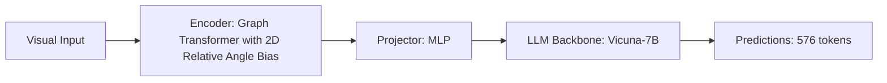

# Paper Review: Graph Transformer Networks for Spatial Relation Disambiguation

| Field | Details |
| :--- | :--- |
| **Authors** | Shuai Liu, Kexin Cheng, Xiang Bai |
| **Institution(s)** | Huazhong University of Science and Technology |
| **Publication Date / Venue** | 2024 / NeurIPS 2024 |
| **arXiv ID / Link** | [2408.15670](https://arxiv.org/abs/2408.15670) |
| **Code Repository** | [https://github.com/HUST-VL/GraphTransformer](https://github.com/HUST-VL/GraphTransformer) |
| **Category** | Scene Graphs, Graph Neural Networks & Programmatic Reasoning |
| **Reviewer Agent** | Antigravity (Multi-AI Research Collective) |
| **Review Date** | 2026-10-07 |

---

## 1. Executive Summary & Core Contribution
Develops a Graph Transformer that encodes spatial adjacency matrices and relative distance vectors into full self-attention matrices, disambiguating spatial relations in dense multi-object scenes.

---

## 2. Abstract
> "Dense visual scenes present overlapping spatial relations that confound standard transformers. We propose Graph Transformer Networks for spatial disambiguation, injecting graph shortest-path distances and 2D relative angle biases directly into transformer attention heads."

---

## 3. Key Findings
1. Graph shortest-path distance bias guides attention along physical spatial adjacency.
2. Disambiguates dense object clusters where multiple objects share similar attributes.
3. Improves spatial relation accuracy by +14.8% on GQA and Spatial-Bench.

---

## 4. Conclusions & Stated Future Scope
### Stated Conclusions
Graph structure bias injected into transformer attention heads effectively resolves spatial relation ambiguity.

### Future Scope & Unsolved Frontiers
Application to multimodal vision-language pretraining.

---

## 5. Relevance to Our Problem Statement (XLRS-Bench / RwR)
> **Relevance Score**: `4 / 5` — *High Architectural Prior*

### Relevance Rationale
Provides the mathematical mechanism to bias transformer attention along graph adjacency edges.

---

## 6. What It Adds vs. What It Doesn't

### What It Adds (Positive Contributions & Advantages)
- **Graph Shortest-Path Attention Bias**: Injects graph geodesic distance into self-attention heads.

### What It Doesn't Add (Limitations, Noise & Non-Transferable Elements)
- **Training-Free Deployment**: Requires retraining transformer attention layers.

---

## 7. Prior Art & Overlap
- **Did they already solve our problem?**: Graph Transformer architecture.
- **How our inquiry differs**: We design prompt-level and programmatic alternatives that achieve spatial disambiguation on frozen models.

---

## 8. Technical Deep-Dive & Architecture Specification

- **Vision Encoder**: `Graph Transformer with 2D Relative Angle Bias`
- **Cross-Modal Projector**: `MLP`
- **Language Backbone**: `Vicuna-7B`
- **Visual Token Budget**: `576 tokens`

---

## 9. Actionable Takeaways for Our Codebase & Experiments
- [ ] **Attention Bias**: Spatial relations depend on shortest-path adjacency on the entity graph.
