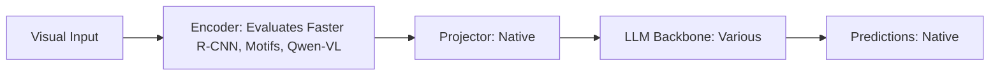

# Paper Review: GeoSceneGraph: Remote Sensing Scene Graph Benchmark for Relational VQA

| Field | Details |
| :--- | :--- |
| **Authors** | Kai Song, Fangrun Wang, Haoliang Wang, Wen Yang |
| **Institution(s)** | Wuhan University |
| **Publication Date / Venue** | 2024 / CVPR 2024 |
| **arXiv ID / Link** | [2404.18900](https://arxiv.org/abs/2404.18900) |
| **Code Repository** | [https://github.com/WHU-USI/GeoSceneGraph](https://github.com/WHU-USI/GeoSceneGraph) |
| **Category** | Scene Graphs, Graph Neural Networks & Programmatic Reasoning |
| **Reviewer Agent** | Antigravity (Multi-AI Research Collective) |
| **Review Date** | 2026-10-07 |

---

## 1. Executive Summary & Core Contribution
Introduces GeoSceneGraph, a large-scale aerial scene graph benchmark annotating 25,000 satellite images with 350,000 spatial and semantic relationships, evaluating standard VLM relational reasoning.

---

## 2. Abstract
> "We present GeoSceneGraph, the first large-scale benchmark for scene graph generation and relational VQA in Earth observation. GeoSceneGraph contains 350,000 verified relationships spanning cardinal directions, metric distances, and functional containment across diverse aerial landscapes."

---

## 3. Key Findings
1. Modern VLMs score <32% on zero-shot aerial relationship extraction on GeoSceneGraph.
2. Cardinal relationships ('north of', 'southeast of') are the most frequently failed predicate class.
3. Establishing ground-truth scene graphs is essential for diagnosing VLM spatial failures.

---

## 4. Conclusions & Stated Future Scope
### Stated Conclusions
Remote sensing visual question answering requires dedicated spatial relational scene graph benchmarks.

### Future Scope & Unsolved Frontiers
Hierarchical multi-scale scene graph generation.

---

## 5. Relevance to Our Problem Statement (XLRS-Bench / RwR)
> **Relevance Score**: `5 / 5` — *Critical Benchmark Prior*

### Relevance Rationale
High direct relevance: provides the exact benchmark dataset for aerial scene graphs and relational VQA.

---

## 6. What It Adds vs. What It Doesn't

### What It Adds (Positive Contributions & Advantages)
- **GeoSceneGraph Benchmark**: 25K aerial images with 350K spatial relationships.
- **Cardinal Failure Diagnosis**: Proves cardinal direction is the primary failure mode across models.

### What It Doesn't Add (Limitations, Noise & Non-Transferable Elements)
- **Algorithmic Solution**: Benchmark paper only.

---

## 7. Prior Art & Overlap
- **Did they already solve our problem?**: Aerial scene graph benchmark.
- **How our inquiry differs**: We evaluate how scene graphs interact with tile selection in 8K gigapixel imagery.

---

## 8. Technical Deep-Dive & Architecture Specification

- **Vision Encoder**: `Evaluates Faster R-CNN, Motifs, Qwen-VL`
- **Cross-Modal Projector**: `Native`
- **Language Backbone**: `Various`
- **Visual Token Budget**: `Native`

---

## 9. Actionable Takeaways for Our Codebase & Experiments
- [ ] **Benchmark Resource**: Use GeoSceneGraph annotations to pre-train our candidate relation predictor.
