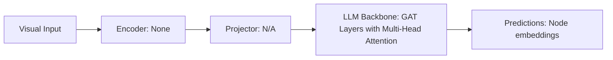

# Paper Review: Graph Attention Networks

| Field | Details |
| :--- | :--- |
| **Authors** | Petar Velickovic, Guillem Cucurull, Arantxa Casanova, Adriana Romero, Pietro Lio, Yoshua Bengio |
| **Institution(s)** | University of Cambridge, Montreal Institute for Learning Algorithms (MILA) |
| **Publication Date / Venue** | 2018 / ICLR 2018 |
| **arXiv ID / Link** | [1710.10903](https://arxiv.org/abs/1710.10903) |
| **Code Repository** | [https://github.com/PetarV-/GAT](https://github.com/PetarV-/GAT) |
| **Category** | Scene Graphs, Graph Neural Networks & Programmatic Reasoning |
| **Reviewer Agent** | Antigravity (Multi-AI Research Collective) |
| **Review Date** | 2026-10-07 |

---

## 1. Executive Summary & Core Contribution
Introduced Graph Attention Networks (GAT), enabling nodes to assign dynamic attention weights to neighboring nodes, overcoming GCN's static isotropic neighborhood averaging.

---

## 2. Abstract
> "We present Graph Attention Networks (GAT), introducing masked self-attention to graph-structured data. By calculating dynamic attention weights over neighboring nodes, GAT enables anisotropic message passing without computationally expensive matrix operations."

---

## 3. Key Findings
1. Self-attention over graph neighbors allows anisotropic feature aggregation.
2. Preserves spatial orientation between connected nodes by weighting directional neighbors differently.
3. Foundational graph attention mechanism.

---

## 4. Conclusions & Stated Future Scope
### Stated Conclusions
Attention mechanisms dynamically modulate message passing strength across distinct relational graph edges.

### Future Scope & Unsolved Frontiers
Edge-featured graph attention.

---

## 5. Relevance to Our Problem Statement (XLRS-Bench / RwR)
> **Relevance Score**: `4 / 5` — *Foundational Graph Attention*

### Relevance Rationale
Directly bridges Graph Neural Networks and Transformer attention.

---

## 6. What It Adds vs. What It Doesn't

### What It Adds (Positive Contributions & Advantages)
- **Graph Attention Mechanism**: Self-attention constrained to graph adjacency edges.

### What It Doesn't Add (Limitations, Noise & Non-Transferable Elements)
- **Multimodal Image Inputs**: Evaluated on citation graphs.

---

## 7. Prior Art & Overlap
- **Did they already solve our problem?**: Foundational graph attention paper.
- **How our inquiry differs**: We use spatial graph attention to model relationships between detected aerial objects.

---

## 8. Technical Deep-Dive & Architecture Specification

- **Vision Encoder**: `None`
- **Cross-Modal Projector**: `N/A`
- **Language Backbone**: `GAT Layers with Multi-Head Attention`
- **Visual Token Budget**: `Node embeddings`

---

## 9. Actionable Takeaways for Our Codebase & Experiments
- [ ] **Mechanism Insight**: Graph attention provides the ideal structural inductive bias for spatial relational reasoning.
