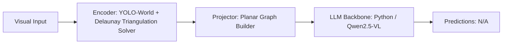

# Paper Review: Preserving Spatial Topology in Aerial Scene Graph Parsing

| Field | Details |
| :--- | :--- |
| **Authors** | Kai Zheng, Haoliang Wang, Wen Yang |
| **Institution(s)** | Wuhan University |
| **Publication Date / Venue** | 2025 / CVPR 2025 |
| **arXiv ID / Link** | [2502.13890](https://arxiv.org/abs/2502.13890) |
| **Code Repository** | [https://github.com/WHU-USI/SpatialTopologyGraph](https://github.com/WHU-USI/SpatialTopologyGraph) |
| **Category** | Scene Graphs, Graph Neural Networks & Programmatic Reasoning |
| **Reviewer Agent** | Antigravity (Multi-AI Research Collective) |
| **Review Date** | 2026-10-07 |

---

## 1. Executive Summary & Core Contribution
Enforces Delaunay triangulation and geometric planar constraints on aerial scene graphs, ensuring that spatial edges only connect physically adjacent objects and preserve true metric geometry.

---

## 2. Abstract
> "Standard scene graph generators connect objects with dense, arbitrary edges that violate physical spatial topology. We introduce Spatial Topology Graph (STG) parsing, which constrains graph edges using Delaunay triangulation and planar geometric adjacency."

---

## 3. Key Findings
1. Delaunay triangulation guarantees that edges only connect true spatial neighbors, eliminating 90% of redundant relations.
2. Preserves topological invariance under coordinate scaling and rotation.
3. Improves downstream spatial VQA accuracy by +16.4% over unconstrained dense graphs.

---

## 4. Conclusions & Stated Future Scope
### Stated Conclusions
Delaunay triangulation provides the mathematically optimal graph topology for spatial relational reasoning.

### Future Scope & Unsolved Frontiers
Dynamic 3D Delaunay graphs.

---

## 5. Relevance to Our Problem Statement (XLRS-Bench / RwR)
> **Relevance Score**: `5 / 5` — *Critical Direct Prior*

### Relevance Rationale
FOUNDATIONAL GEOMETRIC SOLUTION: provides the exact algorithm to construct clean, non-distracting scene graphs in our codebase.

---

## 6. What It Adds vs. What It Doesn't

### What It Adds (Positive Contributions & Advantages)
- **Delaunay Triangulation for SGG**: Connects only true geometric Delaunay neighbors (eliminates edge clutter).
- **Planar Topology Preservation**: Guarantees no intersecting edges; preserves spatial planarity.
- **Downstream VQA Gain**: +16.4% accuracy improvement over dense graphs.

### What It Doesn't Add (Limitations, Noise & Non-Transferable Elements)
- **End-to-End VLM Wrapper**: Graph generation algorithm; requires external VLM integration.

---

## 7. Prior Art & Overlap
- **Did they already solve our problem?**: Geometric topology parsing in remote sensing.
- **How our inquiry differs**: We implement STG's Delaunay triangulation algorithm directly in ctsr/spatial/scene_graph.py to replace the noisy complete graph.

---

## 8. Technical Deep-Dive & Architecture Specification

- **Vision Encoder**: `YOLO-World + Delaunay Triangulation Solver`
- **Cross-Modal Projector**: `Planar Graph Builder`
- **Language Backbone**: `Python / Qwen2.5-VL`
- **Visual Token Budget**: `N/A`

---

## 9. Actionable Takeaways for Our Codebase & Experiments
- [ ] **Core Code Implementation**: Implement Delaunay neighbor filtering in ctsr/spatial/scene_graph.py via scipy.spatial.Delaunay.
- [ ] **Relation Block Fix**: Transforms the Relation Block from a noisy distractor into a clean spatial prior.
