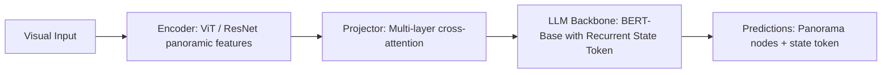

# Paper Review: VLN-BERT: A Recurrent Vision-and-Language Navigation Model

| Field | Details |
| :--- | :--- |
| **Authors** | Yicong Hong, Qi Wu, Yuankai Qi, Cristian Rodriguez-Opazo, Stephen Gould |
| **Institution(s)** | Australian National University, University of Adelaide |
| **Publication Date / Venue** | 2021 / CVPR 2021 |
| **arXiv ID / Link** | [2011.13922](https://arxiv.org/abs/2011.13922) |
| **Code Repository** | [https://github.com/YicongHong/Recurrent-VLN-BERT](https://github.com/YicongHong/Recurrent-VLN-BERT) |
| **Category** | Embodied AI, 3D Vision-Language & Robot Navigation |
| **Reviewer Agent** | Antigravity (Multi-AI Research Collective) |
| **Review Date** | 2026-10-07 |

---

## 1. Executive Summary & Core Contribution
Adapts BERT transformers to Vision-and-Language Navigation via a recurrent state representation that maintains spatial memory across multi-step visual navigation trajectories.

---

## 2. Abstract
> "Standard transformers lack recurrent memory across long sequential trajectories. Recurrent VLN-BERT incorporates a recurrent state token that persists across navigation steps, maintaining temporal and spatial trajectory context."

---

## 3. Key Findings
1. Recurrent state tokens maintain spatial navigation history across long paths.
2. Cross-modal attention between language instructions and panoramic visual candidate nodes.
3. SOTA navigation success rate on Room-to-Room benchmark.

---

## 4. Conclusions & Stated Future Scope
### Stated Conclusions
Maintaining a persistent recurrent spatial state is necessary for tracking long-horizon trajectories.

### Future Scope & Unsolved Frontiers
Continuous action spaces.

---

## 5. Relevance to Our Problem Statement (XLRS-Bench / RwR)
> **Relevance Score**: `3 / 5` — *Moderate VLN Prior*

### Relevance Rationale
Highlights the necessity of persistent spatial memory across sequential visual steps.

---

## 6. What It Adds vs. What It Doesn't

### What It Adds (Positive Contributions & Advantages)
- **Recurrent State Transformer**: Maintains persistent spatial memory across navigation steps.

### What It Doesn't Add (Limitations, Noise & Non-Transferable Elements)
- **Nadir Remote Sensing**: First-person indoor navigation.

---

## 7. Prior Art & Overlap
- **Did they already solve our problem?**: Transformer-based VLN.
- **How our inquiry differs**: We operate on static 8K satellite maps where routes are planned globally in one view.

---

## 8. Technical Deep-Dive & Architecture Specification

- **Vision Encoder**: `ViT / ResNet panoramic features`
- **Cross-Modal Projector**: `Multi-layer cross-attention`
- **Language Backbone**: `BERT-Base with Recurrent State Token`
- **Visual Token Budget**: `Panorama nodes + state token`

---

## 9. Actionable Takeaways for Our Codebase & Experiments
- [ ] **Memory Principle**: Route planning requires maintaining global map orientation throughout path tracing.
