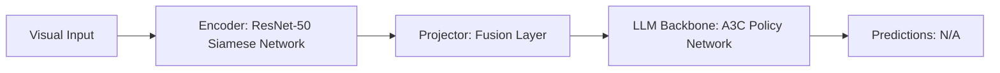

# Paper Review: Target-Driven Visual Navigation in Indoor Scenes using Deep Reinforcement Learning

| Field | Details |
| :--- | :--- |
| **Authors** | Yuke Zhu, Roozbeh Mottaghi, Eric Kolve, Joseph J. Lim, Abhinav Gupta, Li Fei-Fei, Ali Farhadi |
| **Institution(s)** | Stanford University, Allen Institute for AI (AI2) |
| **Publication Date / Venue** | 2017 / ICRA 2017 |
| **arXiv ID / Link** | [1609.05143](https://arxiv.org/abs/1609.05143) |
| **Code Repository** | [https://github.com/allenai/target-driven-visual-navigation](https://github.com/allenai/target-driven-visual-navigation) |
| **Category** | Embodied AI, 3D Vision-Language & Robot Navigation |
| **Reviewer Agent** | Antigravity (Multi-AI Research Collective) |
| **Review Date** | 2026-10-07 |

---

## 1. Executive Summary & Core Contribution
Pioneered target-driven visual navigation, conditioning reinforcement learning policies on both the current visual observation and a target goal image.

---

## 2. Abstract
> "We address the problem of target-driven visual navigation. We formulate navigation using deep reinforcement learning where the input is both the current observation and a visual target image, learning generic spatial navigation representations."

---

## 3. Key Findings
1. Siamese feature comparison between current observation and target image guides spatial movement.
2. Learns implicit spatial maps of room layout.
3. Generalizes to new targets across unseen physical scenes.

---

## 4. Conclusions & Stated Future Scope
### Stated Conclusions
Joint representation of current observation and visual target enables goal-directed spatial navigation.

### Future Scope & Unsolved Frontiers
Natural language goal specifications.

---

## 5. Relevance to Our Problem Statement (XLRS-Bench / RwR)
> **Relevance Score**: `3 / 5` — *Foundational Visual Navigation*

### Relevance Rationale
Early formulation of goal-directed visual navigation.

---

## 6. What It Adds vs. What It Doesn't

### What It Adds (Positive Contributions & Advantages)
- **Target-Driven Siamese Navigation**: Compares current view against target image goal.

### What It Doesn't Add (Limitations, Noise & Non-Transferable Elements)
- **Natural Language VQA**: Goal specified by image rather than text question.

---

## 7. Prior Art & Overlap
- **Did they already solve our problem?**: Target-driven visual navigation.
- **How our inquiry differs**: We use natural language queries and foundation Vision-Language Models.

---

## 8. Technical Deep-Dive & Architecture Specification

- **Vision Encoder**: `ResNet-50 Siamese Network`
- **Cross-Modal Projector**: `Fusion Layer`
- **Language Backbone**: `A3C Policy Network`
- **Visual Token Budget**: `N/A`

---

## 9. Actionable Takeaways for Our Codebase & Experiments
- [ ] **Goal Comparison**: Compare detected crop features directly against question target embeddings.
