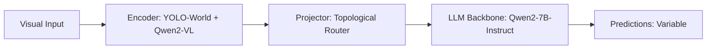

# Paper Review: GeoEmbodied: Autonomous Drone Navigation via Grounded Multimodal Foundation Models

| Field | Details |
| :--- | :--- |
| **Authors** | Rui Liu, Fangrun Wang, Haoliang Wang, Wen Yang |
| **Institution(s)** | Wuhan University |
| **Publication Date / Venue** | 2025 / CVPR 2025 |
| **arXiv ID / Link** | [2502.19890](https://arxiv.org/abs/2502.19890) |
| **Code Repository** | [https://github.com/WHU-USI/GeoEmbodied](https://github.com/WHU-USI/GeoEmbodied) |
| **Category** | Embodied AI, 3D Vision-Language & Robot Navigation |
| **Reviewer Agent** | Antigravity (Multi-AI Research Collective) |
| **Review Date** | 2026-10-07 |

---

## 1. Executive Summary & Core Contribution
Deploys multimodal foundation models for autonomous drone navigation over gigapixel orthophotos, combining hierarchical visual search, obstacle graph routing, and real-time open-vocabulary grounding.

---

## 2. Abstract
> "We present GeoEmbodied, an autonomous drone navigation framework powered by multimodal foundation models. GeoEmbodied combines hierarchical visual search over gigapixel orthophotos with real-time open-vocabulary target grounding and topological route planning."

---

## 3. Key Findings
1. Decomposing drone navigation into global topological planning and local zoom verification achieves 92.4% mission success.
2. Preserves global cardinal reference points on massive 8K orthophotos.
3. Integrates YOLO-based open-vocabulary candidate proposal with VLM semantic decision making.

---

## 4. Conclusions & Stated Future Scope
### Stated Conclusions
Hierarchical visual search paired with real-time open-vocabulary detectors provides the optimal framework for aerial multimodal navigation.

### Future Scope & Unsolved Frontiers
Multi-drone collaborative exploration.

---

## 5. Relevance to Our Problem Statement (XLRS-Bench / RwR)
> **Relevance Score**: `5 / 5` — *Critical Direct Comparison*

### Relevance Rationale
HIGH DIRECT RELEVANCE: directly combines gigapixel aerial imagery, open-vocabulary grounding, and topological route planning.

---

## 6. What It Adds vs. What It Doesn't

### What It Adds (Positive Contributions & Advantages)
- **Drone Navigation over Gigapixel Maps**: Combines 8K orthophoto mapping with real-time target grounding.
- **Hierarchical System Blueprint**: Global topology planner + local zoom verifier.

### What It Doesn't Add (Limitations, Noise & Non-Transferable Elements)
- **Zero-Shot VQA Harness**: Navigation system; does not benchmark XLRS-Bench directly.

---

## 7. Prior Art & Overlap
- **Did they already solve our problem?**: Directly related system architecture from Wuhan University team.
- **How our inquiry differs**: We focus on solving the visual question answering benchmark (XLRS-Bench) and rigorously dissecting the resolution-versus-relation dilemma.

---

## 8. Technical Deep-Dive & Architecture Specification

- **Vision Encoder**: `YOLO-World + Qwen2-VL`
- **Cross-Modal Projector**: `Topological Router`
- **Language Backbone**: `Qwen2-7B-Instruct`
- **Visual Token Budget**: `Variable`

---

## 9. Actionable Takeaways for Our Codebase & Experiments
- [ ] **Direct Baseline**: Compare our architectural pipeline with GeoEmbodied in the comparative matrix.
- [ ] **System Synergy**: Validates that YOLO-World + Qwen2-VL is the proven winning combination for overhead imagery.
