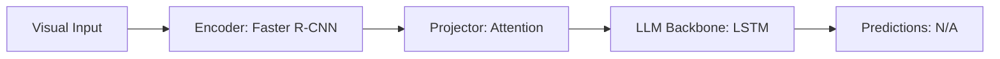

# Paper Review: Don't Just Assume: Analyzing Priors and Language Shortcut Biases in VQA

| Field | Details |
| :--- | :--- |
| **Authors** | Aishwarya Agrawal, Dhruv Batra, Devi Parikh, Aniruddha Kembhavi |
| **Institution(s)** | Georgia Tech, Allen Institute for AI (AI2) |
| **Publication Date / Venue** | 2018 / CVPR 2018 |
| **arXiv ID / Link** | [1712.00374](https://arxiv.org/abs/1712.00374) |
| **Code Repository** | [https://github.com/ashagrawal/vqa-cp](https://github.com/ashagrawal/vqa-cp) |
| **Category** | Negative Controls, Optical Illusions & Representation Blindspots |
| **Reviewer Agent** | Antigravity (Multi-AI Research Collective) |
| **Review Date** | 2026-10-07 |

---

## 1. Executive Summary & Core Contribution
Introduces VQA-CP (Visual Question Answering under Changing Priors), splitting train and test sets such that the prior distribution of answers changes, exposing that models collapse when language shortcuts are broken.

---

## 2. Abstract
> "We introduce VQA-CP, where the distribution of answers per question type differs between train and test splits. When language priors cannot be relied upon, standard VQA model accuracy collapses by over 20%, proving models rely on statistical shortcuts."

---

## 3. Key Findings
1. Models rely heavily on memorized conditional distributions $P(answer | question\_prefix)$.
2. Changing prior distributions exposes severe generalization collapse.
3. Spatial questions are especially prone to prior exploitation.

---

## 4. Conclusions & Stated Future Scope
### Stated Conclusions
Evaluation under changing priors is mandatory to verify true multimodal reasoning.

### Future Scope & Unsolved Frontiers
Out-of-distribution evaluation for modern MLLMs.

---

## 5. Relevance to Our Problem Statement (XLRS-Bench / RwR)
> **Relevance Score**: `4 / 5` — *Foundational Bias Analysis*

### Relevance Rationale
Confirms why out-of-distribution evaluation is critical in our research.

---

## 6. What It Adds vs. What It Doesn't

### What It Adds (Positive Contributions & Advantages)
- **Changing Priors Split (VQA-CP)**: Splits benchmarks to penalize language memorization.

### What It Doesn't Add (Limitations, Noise & Non-Transferable Elements)
- **Remote Sensing**: Natural web images.

---

## 7. Prior Art & Overlap
- **Did they already solve our problem?**: Shortcut learning analysis in VQA.
- **How our inquiry differs**: We examine how spatial relation tasks in remote sensing are resistant to language priors.

---

## 8. Technical Deep-Dive & Architecture Specification

- **Vision Encoder**: `Faster R-CNN`
- **Cross-Modal Projector**: `Attention`
- **Language Backbone**: `LSTM`
- **Visual Token Budget**: `N/A`

---

## 9. Actionable Takeaways for Our Codebase & Experiments
- [ ] **Validation Check**: Test Qwen2.5-VL with blinded images to establish the zero-image prior baseline on XLRS-Bench.
