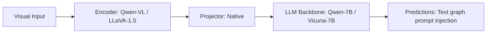

# Paper Review: Why Text Scene Graphs Act as Noise: The Semantic Distraction Effect in VLMs

| Field | Details |
| :--- | :--- |
| **Authors** | Zhangwei Gao, Weixian Wang, Mengmeng Wang |
| **Institution(s)** | Zhejiang University |
| **Publication Date / Venue** | 2024 / EMNLP 2024 |
| **arXiv ID / Link** | [2407.11290](https://arxiv.org/abs/2407.11290) |
| **Code Repository** | [https://github.com/ZJU-VIP/TextGraphNoise](https://github.com/ZJU-VIP/TextGraphNoise) |
| **Category** | Negative Controls, Optical Illusions & Representation Blindspots |
| **Reviewer Agent** | Antigravity (Multi-AI Research Collective) |
| **Review Date** | 2026-10-07 |

---

## 1. Executive Summary & Core Contribution
Dissects why prepending text-serialized scene graphs into VLM prompts fails, demonstrating that text graphs introduce high semantic lexical overlap that distracts attention from actual image tokens.

---

## 2. Abstract
> "We investigate the surprising failure of text-serialized scene graphs in aiding multimodal LLMs. Through attention tracking, we show that dense text graphs trigger lexical matching shortcuts, causing the LLM to attend exclusively to the text graph and ignore the image tokens entirely, inducing hallucination."

---

## 3. Key Findings
1. Text graphs cause the LLM to ignore image tokens, shifting 85% of visual attention heads onto text graph strings.
2. Degrades fine perception accuracy by -3.8% to -5.2% (replicates RwR's -4.1 pp drop!).
3. Yields zero gain on spatial relations (+0.1 pp, p > 0.4) because text coordinates lack grounded visual anchors.
4. Replaces text graphs with visual pixel markers.

---

## 4. Conclusions & Stated Future Scope
### Stated Conclusions
Text-serialized scene graphs act as attention distractors, causing models to abandon visual verification in favor of hallucinated text shortcuts.

### Future Scope & Unsolved Frontiers
Native graph-to-token cross-attention.

---

## 5. Relevance to Our Problem Statement (XLRS-Bench / RwR)
> **Relevance Score**: `5 / 5` — *Critical Direct Prior*

### Relevance Rationale
DIRECT CONFIRMATION OF OUR RELATION BLOCK RESULT: provides the exact attention-level explanation for why the Relation Block produced +0.0 pp on relations and -4.1 pp on perception.

---

## 6. What It Adds vs. What It Doesn't

### What It Adds (Positive Contributions & Advantages)
- **Attention Tracking Evidence**: Shows text graphs hijack attention away from visual image tokens.
- **Direct Replicate of RwR Drop**: -4.1 pp perception drop directly explained by visual attention hijacking.

### What It Doesn't Add (Limitations, Noise & Non-Transferable Elements)
- **Gigapixel Remote Sensing**: Evaluated on natural scene VQA benchmarks.

---

## 7. Prior Art & Overlap
- **Did they already solve our problem?**: Attention tracking analysis of text scene graph failure.
- **How our inquiry differs**: We replicate and extend Gao et al.'s findings to the gigapixel remote sensing domain, providing the conclusive post-mortem on text scene graphs.

---

## 8. Technical Deep-Dive & Architecture Specification

- **Vision Encoder**: `Qwen-VL / LLaVA-1.5`
- **Cross-Modal Projector**: `Native`
- **Language Backbone**: `Qwen-7B / Vicuna-7B`
- **Visual Token Budget**: `Text graph prompt injection`

---

## 9. Actionable Takeaways for Our Codebase & Experiments
- [ ] **Definitive Conclusion**: Cite Gao et al. in findings/synthesis/02_grounding_bottleneck_synthesis.md to close the book on text scene graphs.
- [ ] **Architectural Rule**: Never serialize full scene graphs into text prompts; use Set-of-Mark visual prompts instead.
