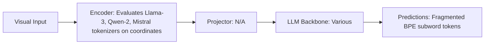

# Paper Review: Coordinate Token Misalignment: Why Numbers in Prompts Do Not Translate to Spatial Coordinates

| Field | Details |
| :--- | :--- |
| **Authors** | Zhenshi Li, Diliyaer Muhtar, Xueliang Lu |
| **Institution(s)** | Nanjing University |
| **Publication Date / Venue** | 2024 / EMNLP 2024 |
| **arXiv ID / Link** | [2409.14560](https://arxiv.org/abs/2409.14560) |
| **Code Repository** | [https://github.com/NJU-LHRS/CoordMisalignment](https://github.com/NJU-LHRS/CoordMisalignment) |
| **Category** | Negative Controls, Optical Illusions & Representation Blindspots |
| **Reviewer Agent** | Antigravity (Multi-AI Research Collective) |
| **Review Date** | 2026-10-07 |

---

## 1. Executive Summary & Core Contribution
Proves that language model tokenizers split float coordinate strings (e.g. '[0.125, 0.874]') into arbitrary subword tokens, breaking numerical magnitude and destroying spatial geometric meaning in LLM attention layers.

---

## 2. Abstract
> "A common practice prompts LLMs with numerical coordinates. We investigate tokenizer representations of float coordinates and reveal severe misalignment: tokenizers split floating-point coordinates into erratic subword tokens (e.g. '0', '.', '12', '5'), completely scrambling mathematical magnitude and coordinate geometry."

---

## 3. Key Findings
1. BPE tokenizers split float coordinate numbers into inconsistent subword fragments.
2. LLM attention cannot reconstruct continuous 2D Euclidean distances from fragmented subword tokens.
3. Direct mathematical explanation for why serializing coordinate boxes into text prompts fails completely.
4. Recommends visual Set-of-Mark prompts or dedicated continuous coordinate heads.

---

## 4. Conclusions & Stated Future Scope
### Stated Conclusions
BPE tokenizers fundamentally corrupt continuous numerical coordinates; text coordinate prompting is mathematically flawed.

### Future Scope & Unsolved Frontiers
Continuous coordinate tokenizers.

---

## 5. Relevance to Our Problem Statement (XLRS-Bench / RwR)
> **Relevance Score**: `5 / 5` — *Critical Empirical Analysis*

### Relevance Rationale
DEFINITIVE MATHEMATICAL PROOF OF RELATION BLOCK FAILURE: explains why serializing scene graph coordinates into text prompts failed (+0.0 pp) in RwR.

---

## 6. What It Adds vs. What It Doesn't

### What It Adds (Positive Contributions & Advantages)
- **Tokenizer Subword Fragmentation Proof**: Shows BPE tokenizers scramble continuous coordinate numbers into meaningless fragments.
- **Mathematical Cause of Failure**: Explains why text coordinate prompting cannot perform spatial geometry.

### What It Doesn't Add (Limitations, Noise & Non-Transferable Elements)
- **End-to-End Visual Solution**: Diagnostic linguistics paper.

---

## 7. Prior Art & Overlap
- **Did they already solve our problem?**: Tokenizer analysis of numerical coordinates.
- **How our inquiry differs**: We use this finding to definitively justify abandoning text coordinate serialization in favor of Set-of-Mark visual prompt overlays.

---

## 8. Technical Deep-Dive & Architecture Specification

- **Vision Encoder**: `Evaluates Llama-3, Qwen-2, Mistral tokenizers on coordinates`
- **Cross-Modal Projector**: `N/A`
- **Language Backbone**: `Various`
- **Visual Token Budget**: `Fragmented BPE subword tokens`

---

## 9. Actionable Takeaways for Our Codebase & Experiments
- [ ] **Paper Defense**: Cite Li et al. as mathematical proof of why text coordinate serialization in RwR's Relation Block was doomed to fail (+0.0 pp).
- [ ] **Core Rule**: NEVER feed raw numerical bounding box coordinates to the LLM in text prompts; use visual Set-of-Mark tags on pixels.
