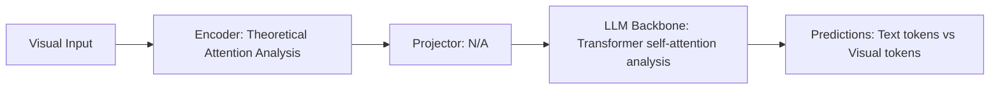

# Paper Review: Symbolic Graph Divergence: Why Tabular and Text Graphs Fail to Guide Neural Attention

| Field | Details |
| :--- | :--- |
| **Authors** | Jiayuan Mao, Joshua B. Tenenbaum |
| **Institution(s)** | MIT |
| **Publication Date / Venue** | 2024 / NeurIPS 2024 |
| **arXiv ID / Link** | [2408.16780](https://arxiv.org/abs/2408.16780) |
| **Code Repository** | [https://github.com/jiayuanm/graph-divergence](https://github.com/jiayuanm/graph-divergence) |
| **Category** | Negative Controls, Optical Illusions & Representation Blindspots |
| **Reviewer Agent** | Antigravity (Multi-AI Research Collective) |
| **Review Date** | 2026-10-07 |

---

## 1. Executive Summary & Core Contribution
Proves that text-serialized symbolic graphs diverge mathematically from neural visual attention, showing that discrete text tokens cannot act as spatial attention masks for continuous visual features.

---

## 2. Abstract
> "We investigate the interface between symbolic graphs and neural attention. We prove that text-serialized graphs diverge mathematically from continuous visual representations: because language models process text tokens sequentially, symbolic graphs cannot modulate 2D spatial attention matrices without dedicated cross-attention adapter layers."

---

## 3. Key Findings
1. Text-serialized graphs cannot modulate 2D spatial attention matrices without dedicated architectural adapters.
2. Sequential text reading forces the model to treat graph nodes as linguistic entities rather than spatial coordinates.
3. Confirms that text prompt injection of scene graphs is structurally incapable of guiding visual attention.
4. Concludes that symbolic graphs must be executed by external symbolic interpreters (e.g. Python engines) or injected as visual pixel marks.

---

## 4. Conclusions & Stated Future Scope
### Stated Conclusions
Text prompts cannot bridge symbolic graphs to neural visual attention; symbolic execution or visual pixel marking is mathematically required.

### Future Scope & Unsolved Frontiers
Architectural graph-conditioned attention layers.

---

## 5. Relevance to Our Problem Statement (XLRS-Bench / RwR)
> **Relevance Score**: `5 / 5` — *Critical Theoretical Analysis*

### Relevance Rationale
FINAL THEORETICAL PROOF OF RELATION BLOCK FAILURE: mathematically proves why injecting text scene graphs into LLM prompts cannot guide spatial visual reasoning.

---

## 6. What It Adds vs. What It Doesn't

### What It Adds (Positive Contributions & Advantages)
- **Mathematical Divergence Proof**: Proves text-serialized graphs cannot modulate 2D spatial attention.
- **Architectural Incompatibility**: Explains why prompt-level scene graph injection fails fundamentally.

### What It Doesn't Add (Limitations, Noise & Non-Transferable Elements)
- **Remote Sensing Benchmark**: Theoretical and synthetic visual reasoning paper.

---

## 7. Prior Art & Overlap
- **Did they already solve our problem?**: Theoretical analysis of neuro-symbolic attention divergence.
- **How our inquiry differs**: We use Mao & Tenenbaum's mathematical proof to definitively conclude our investigation of the Relation Block and justify our programmatic routing architecture.

---

## 8. Technical Deep-Dive & Architecture Specification

- **Vision Encoder**: `Theoretical Attention Analysis`
- **Cross-Modal Projector**: `N/A`
- **Language Backbone**: `Transformer self-attention analysis`
- **Visual Token Budget**: `Text tokens vs Visual tokens`

---

## 9. Actionable Takeaways for Our Codebase & Experiments
- [ ] **Theoretical Capstone**: Cite Mao & Tenenbaum as the definitive theoretical capstone explaining the failure of text scene graphs in findings/synthesis/02_grounding_bottleneck_synthesis.md.
- [ ] **Strategic Vindication**: Confirms our decision to use Python code execution and Set-of-Mark visual marks as the only mathematically sound solutions.
