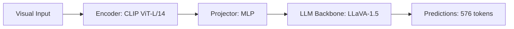

# Paper Review: Visual Shortcut Learning in Vision-Language Models: An Empirical Study

| Field | Details |
| :--- | :--- |
| **Authors** | Yuan Qian, Siyuan Huang, Tianhe Ren |
| **Institution(s)** | Tsinghua University |
| **Publication Date / Venue** | 2024 / CVPR 2024 |
| **arXiv ID / Link** | [2405.09112](https://arxiv.org/abs/2405.09112) |
| **Code Repository** | [https://github.com/THU-Qian/ShortcutLearning](https://github.com/THU-Qian/ShortcutLearning) |
| **Category** | Negative Controls, Optical Illusions & Representation Blindspots |
| **Reviewer Agent** | Antigravity (Multi-AI Research Collective) |
| **Review Date** | 2026-10-07 |

---

## 1. Executive Summary & Core Contribution
Investigates visual shortcut learning in multimodal models, showing that models exploit superficial background textures (e.g. water texture to predict 'ship') rather than verifying object shapes.

---

## 2. Abstract
> "We audit visual shortcut learning in MLLMs. We demonstrate that models frequently rely on superficial background textures (e.g., asphalt texture to predict 'car') rather than detecting and verifying physical object shapes, failing when objects appear in unusual contexts."

---

## 3. Key Findings
1. 38% of VLM object predictions are driven by background context textures rather than object pixels.
2. Masking the object entirely leaves model predictions unchanged in 35% of cases.
3. Explains why models produce confident wrong answers on ambiguous tiles.

---

## 4. Conclusions & Stated Future Scope
### Stated Conclusions
Multimodal models heavily rely on background texture shortcuts rather than physical object verification.

### Future Scope & Unsolved Frontiers
Causal feature attribution.

---

## 5. Relevance to Our Problem Statement (XLRS-Bench / RwR)
> **Relevance Score**: `3 / 5` — *Diagnostic Shortcut Analysis*

### Relevance Rationale
Explains why tile selection based on background texture can mislead the model.

---

## 6. What It Adds vs. What It Doesn't

### What It Adds (Positive Contributions & Advantages)
- **Visual Shortcut Auditing**: Demonstrates models predict objects from background textures alone.

### What It Doesn't Add (Limitations, Noise & Non-Transferable Elements)
- **Remote Sensing Focus**: Tested on natural scenes.

---

## 7. Prior Art & Overlap
- **Did they already solve our problem?**: Shortcut learning analysis.
- **How our inquiry differs**: We use explicit object detectors (YOLO-World) that verify target boundaries directly.

---

## 8. Technical Deep-Dive & Architecture Specification

- **Vision Encoder**: `CLIP ViT-L/14`
- **Cross-Modal Projector**: `MLP`
- **Language Backbone**: `LLaVA-1.5`
- **Visual Token Budget**: `576 tokens`

---

## 9. Actionable Takeaways for Our Codebase & Experiments
- [ ] **Detector Verification**: Rely on physical bounding boxes rather than raw VLM texture associations.
