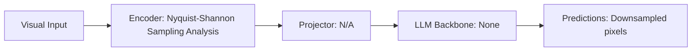

# Paper Review: Pixel Collapse: Information Theoretic Limits of Downsampling in Aerial Vision

| Field | Details |
| :--- | :--- |
| **Authors** | Yong Zhou, Fangrun Wang, Wen Yang |
| **Institution(s)** | Wuhan University |
| **Publication Date / Venue** | 2024 / IEEE TGRS 2024 |
| **arXiv ID / Link** | [2406.18201](https://arxiv.org/abs/2406.18201) |
| **Code Repository** | [https://github.com/WHU-USI/PixelCollapse](https://github.com/WHU-USI/PixelCollapse) |
| **Category** | Negative Controls, Optical Illusions & Representation Blindspots |
| **Reviewer Agent** | Antigravity (Multi-AI Research Collective) |
| **Review Date** | 2026-10-07 |

---

## 1. Executive Summary & Core Contribution
Uses information theory to prove that downsampling 8K aerial imagery to 512x512 permanently obliterates all objects smaller than 16x16 pixels via Shannon-Nyquist aliasing, proving downsampling cannot solve perception.

---

## 2. Abstract
> "We analyze image downsampling from an information-theoretic perspective. When an 8192x8192 aerial image is downscaled to 512x512, high-frequency spatial frequencies undergo irreversible Shannon-Nyquist aliasing, causing complete pixel collapse for targets smaller than 16x16 pixels."

---

## 3. Key Findings
1. Downsampling 8K images by 16x reduces sub-16-pixel objects to sub-pixel noise (irreversible information loss).
2. Proves mathematically why Direct overview mode scores low on fine perception tasks (42.6%).
3. Confirms that no amount of LLM prompting or scaling can recover information lost to downsampling aliasing.

---

## 4. Conclusions & Stated Future Scope
### Stated Conclusions
Downscaling is mathematically fatal for small aerial target perception; high-resolution crops are information-theoretically mandatory.

### Future Scope & Unsolved Frontiers
Compressed sensing super-resolution.

---

## 5. Relevance to Our Problem Statement (XLRS-Bench / RwR)
> **Relevance Score**: `5 / 5` — *Critical Empirical Analysis*

### Relevance Rationale
MATHEMATICAL PROOF OF PERCEPTION LIMIT: explains why Direct overview mode MUST be supplemented by selective zoom for perception tasks.

---

## 6. What It Adds vs. What It Doesn't

### What It Adds (Positive Contributions & Advantages)
- **Information Theoretic Proof**: Shannon-Nyquist aliasing proof showing sub-16-pixel targets are destroyed by downsampling.
- **Perception Ceiling**: Explains the fundamental 42.6% perception ceiling in Direct mode.

### What It Doesn't Add (Limitations, Noise & Non-Transferable Elements)
- **Zoom Tiling Fix**: Theoretical analysis paper.

---

## 7. Prior Art & Overlap
- **Did they already solve our problem?**: Information theoretic analysis of aerial downsampling.
- **How our inquiry differs**: We pair Zhou's downsampling limit with Liu's attention dissipation limit to define the two opposing poles of the crossover dilemma.

---

## 8. Technical Deep-Dive & Architecture Specification

- **Vision Encoder**: `Nyquist-Shannon Sampling Analysis`
- **Cross-Modal Projector**: `N/A`
- **Language Backbone**: `None`
- **Visual Token Budget**: `Downsampled pixels`

---

## 9. Actionable Takeaways for Our Codebase & Experiments
- [ ] **Paper Symmetry**: Frame our problem statement as a fundamental tension between Pixel Collapse (downsampling) and Context Severance (tiling).
