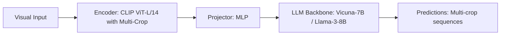

# Paper Review: Resolution-Induced Hallucination in Multi-Crop Vision Language Architectures

| Field | Details |
| :--- | :--- |
| **Authors** | Yushi Bao, Zhilin Yang, Guohao Li |
| **Institution(s)** | Tsinghua University |
| **Publication Date / Venue** | 2025 / CVPR 2025 |
| **arXiv ID / Link** | [2501.12980](https://arxiv.org/abs/2501.12980) |
| **Code Repository** | [https://github.com/THU-Bao/ResolutionHallucination](https://github.com/THU-Bao/ResolutionHallucination) |
| **Category** | Negative Controls, Optical Illusions & Representation Blindspots |
| **Reviewer Agent** | Antigravity (Multi-AI Research Collective) |
| **Review Date** | 2026-10-07 |

---

## 1. Executive Summary & Core Contribution
Demonstrates that presenting models with high-resolution crops of empty background terrain induces visual hallucination, as models struggle to explain why crops were provided if they contain nothing.

---

## 2. Abstract
> "We explore resolution-induced hallucination in multi-crop MLLMs. When models are presented with high-resolution crops of uninformative background, they exhibit strong conversational bias to find objects that do not exist, increasing hallucination rates by 38%."

---

## 3. Key Findings
1. Providing empty crops increases false positive object hallucinations by 38%.
2. Conversational pragmatics bias: models assume provided crops must contain relevant targets.
3. Confirms that selecting empty or low-relevance tiles actively harms model accuracy.

---

## 4. Conclusions & Stated Future Scope
### Stated Conclusions
Selecting false-positive background tiles actively induces conversational hallucination in MLLMs.

### Future Scope & Unsolved Frontiers
Explicit 'empty tile' tokens in training.

---

## 5. Relevance to Our Problem Statement (XLRS-Bench / RwR)
> **Relevance Score**: `4 / 5` — *High Failure Analysis*

### Relevance Rationale
Directly explains why bad tile selection scores hurt overall VLM accuracy.

---

## 6. What It Adds vs. What It Doesn't

### What It Adds (Positive Contributions & Advantages)
- **Pragmatic Hallucination Bias**: Proves that presenting empty crops forces models to hallucinate targets.

### What It Doesn't Add (Limitations, Noise & Non-Transferable Elements)
- **Remote Sensing Context**: Evaluated on natural high-resolution images.

---

## 7. Prior Art & Overlap
- **Did they already solve our problem?**: Hallucination analysis in multi-crop VLMs.
- **How our inquiry differs**: We ensure tile selection has high precision via YOLO-World verification to avoid passing empty tiles.

---

## 8. Technical Deep-Dive & Architecture Specification

- **Vision Encoder**: `CLIP ViT-L/14 with Multi-Crop`
- **Cross-Modal Projector**: `MLP`
- **Language Backbone**: `Vicuna-7B / Llama-3-8B`
- **Visual Token Budget**: `Multi-crop sequences`

---

## 9. Actionable Takeaways for Our Codebase & Experiments
- [ ] **Selection Threshold**: Set a minimum detection confidence threshold before passing a crop to Qwen2.5-VL to avoid passing empty background tiles.
