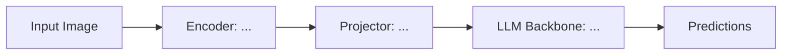

# Paper Review: [Title of Paper]

| Field | Details |
| :--- | :--- |
| **Authors** | [Author List] |
| **Institution(s)** | [Affiliations] |
| **Publication Date / Venue** | [YYYY-MM-DD / Conference / arXiv] |
| **arXiv ID / Link** | [arXiv:XXXX.XXXXX](https://arxiv.org/abs/XXXX.XXXXX) |
| **Code Repository** | [Link to official or community code] |
| **Model Weights / Checkpoints**| [Hugging Face / Open Source Link] |
| **Reviewer Agent** | [Claude / Codex / Antigravity / etc.] |
| **Review Date** | YYYY-MM-DD |

---

## 1. Executive Summary & Core Contribution
*In 2–3 concise paragraphs, summarize the core thesis, the key bottleneck being solved, and the primary empirical or theoretical contribution.*

---

## 2. Relevance to Our Problem Statement
> **Relevance Score**: `[1 to 5]`  
> *(1 = Tangential / Irrelevant, 3 = Useful method/component, 5 = Direct competitor or foundational blueprint)*

### Detailed Rationale
- **Direct Intersections**: How does this paper intersect with [`docs/problem_statement.md`](file:///d:/projects/research/vlm/docs/problem_statement.md)?
- **Target Challenges Addressed**: Which of our specific research questions (RQs) does this speak to?

---

## 3. What It Adds vs. What It Doesn't

### What It Adds (Positive Contributions & Advantages)
- **Architectural Novelty**: (e.g., new projector mechanism, dynamic resolution scheme)
- **Training Recipe**: (e.g., stage-wise alignment, high-quality synthetic data curation)
- **Empirical Gains**: (e.g., +X% on MMMU with 50% fewer visual tokens)

### What It Doesn't Add (Limitations, Noise & Non-Transferable Elements)
- **Unrealistic Compute / Data Assumptions**: (e.g., requires 512 H100 GPUs or proprietary billions of image-text pairs)
- **Blindspots**: (e.g., only tested on OCR, fails on spatial reasoning, causes hallucination spikes)
- **Irrelevant Artifacts**: What parts of the paper can we safely discard?

---

## 4. Prior Art & Overlap
- **Did they already solve our problem?**: [Yes / Partially / No]
- **How does our inquiry differ from their scope?**: 
- **Key differences from canonical baselines** (e.g., LLaVA-1.5, InternVL, Qwen-VL):

---

## 5. Technical Deep-Dive & Architecture

- **Vision Encoder**: (e.g., SigLIP-SO400M, CLIP-ViT-L/14, DINOv2)
- **Modality Connector**: (e.g., 2-layer MLP, Resampler, Cross-Attention)
- **Visual Token Budget**: (Number of tokens per image/crop, downsampling factor)
- **Language Backbone**: (e.g., Qwen2.5-7B, Llama-3-8B)
- **Training Stages & Objectives**:
  1. *Stage 1 (Pre-training / Alignment)*:
  2. *Stage 2 (Instruction Tuning)*:
  3. *Stage 3 (Preference Alignment / DPO)*:

---

## 6. Empirical Results & Critical Benchmark Analysis
- **Key Benchmarks Evaluated**: (e.g., MMMU, MathVista, MMBench, POPE, HallusionBench)
- **Main Performance Numbers**:
- **Critical Ablations**: What actually drove the performance gains according to their ablations?

---

## 7. Critiques, Flaws & Open Questions
- **Methodological Weaknesses**: (e.g., data contamination, weak baselines, cherry-picked qualitative examples)
- **Reproducibility Assessment**: (Are code, configs, and training data fully open?)
- **Open Questions Left Unanswered**:

---

## 8. Actionable Takeaways for Our Codebase & Experiments
- [ ] **Candidate Module to Implement**: (e.g., add `DynamicPatchSplitter` to `src/models/`)
- [ ] **Experiment to Run**: (e.g., evaluate impact of compression ratio $k$ in `experiments/`)
- [ ] **Data / Benchmark to Adopt**: (e.g., integrate evaluation benchmark into `src/evaluation/`)
